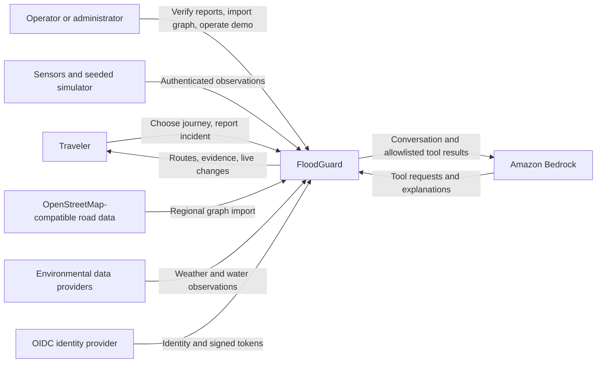
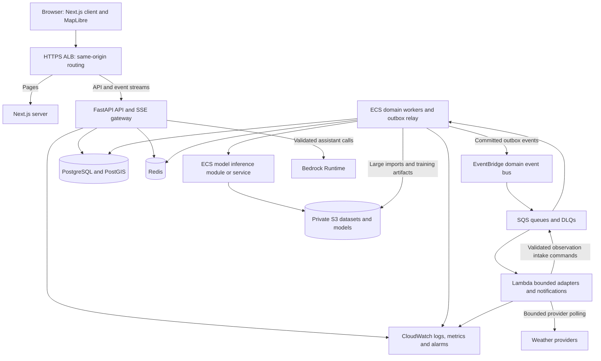
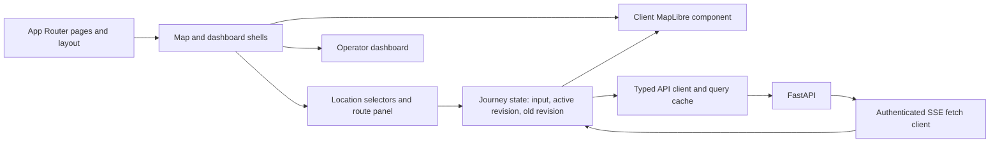
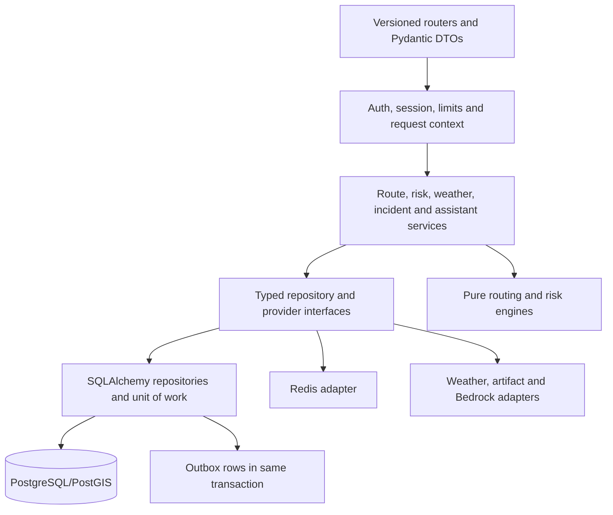
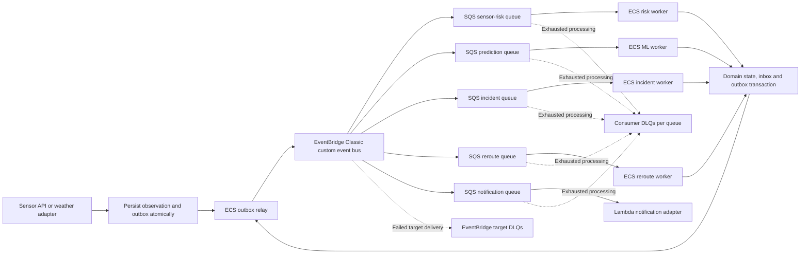
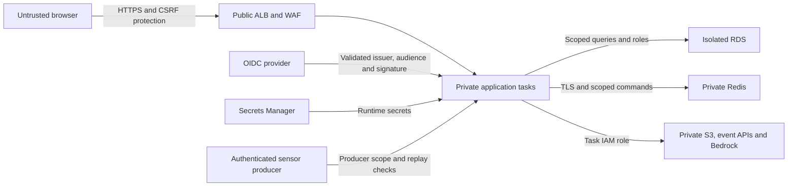
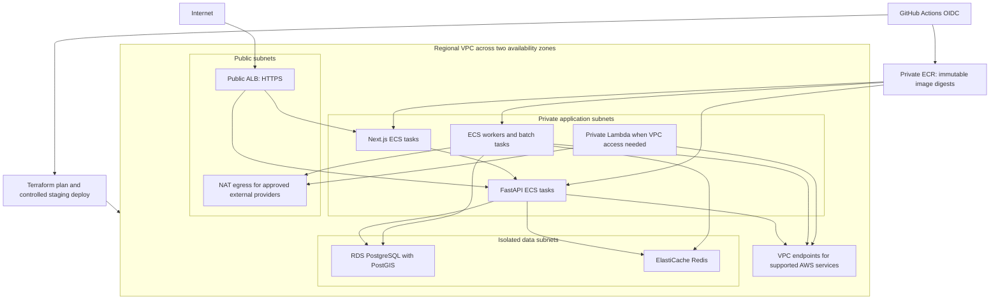

# FloodGuard architecture

Status: Production Architecture (Updated 8 October 2026). Phases 0 through 14 are fully implemented and verified:
- Phase 0–7: PostgreSQL/PostGIS, OSM ingestion, A* routing, deterministic risk, simulation engine.
- Phase 8: Real-time dynamic rerouting, SSE push, browser MapLibre comparison.
- Phase 9: Multi-tier Redis caching (graph, route, risk snapshot, ML cache).
- Phase 10: Environmental data layer (OpenMeteo + Mock adapters).
- Phase 11–13: ML pipeline, offline XGBoost model, conservative risk fusion.
- Phase 14: AWS SQS durable asynchronous event ingress with Redis idempotency and out-of-order suppression.

## Purpose and boundaries

FloodGuard calculates road routes that account for observed and predicted flood conditions, explains the evidence behind a route, and updates active journeys when conditions change. Its first operating unit is one configured city or region, using an OpenStreetMap-compatible directed road graph. Coordinates alone do not imply that a place is covered or reachable.

The backend owns routing and risk decisions. The map displays its results. ML supplies a flood probability to the risk engine. Bedrock explains backend tool results. Neither ML nor the language model chooses a road path or overrides a verified closure. A route is an estimate using timestamped evidence, never a guarantee of safety.

The initial production architecture is a modular monolith with independently deployable workers. Domain services are Python modules sharing a database, not one network service per noun. Split a module into a separate service only when measured resource requirements, failure isolation, or ownership justify it. See [system-design.md](system-design.md) for algorithms, persistence, and consistency, [api-overview.md](api-overview.md) for contracts, and [events.md](events.md) for delivery behavior.

## System context



Basemap tiles are a separate display dependency, not the routing provider. Choose a permitted tile provider or self-hosted tiles, display required attribution, and document its limits. OSM road imports must preserve provenance and comply with its ODbL/attribution requirements, described in [OpenStreetMap's license information](https://www.openstreetmap.org/copyright). The application must work from selected coordinates without a paid geocoder or routing API.

## Container architecture



SQS buffers work for one consumer responsibility. EventBridge fans out committed facts to independent queues. Redis accelerates reads and wake-up delivery; it is not the durable event store or authoritative flood state.

## Responsibilities

| Component | Owns | Boundary |
| --- | --- | --- |
| Frontend | Origin/destination selection, MapLibre layers, route comparison, dashboard, accessible loading/error states, authenticated SSE client | No graph search, risk calculation, AWS credentials, or authoritative safety claims |
| API | Schema validation, auth, rate limits, ownership checks, use-case orchestration, HTTP/SSE contracts, request IDs | No durable jobs in process-local background tasks |
| Routing engine | Directed graph traversal, snapping, Dijkstra/A*, reconstruction, ETA/distance and weighted path cost | Consumes immutable weights; does not call weather or Bedrock |
| Risk engine | Normalization, closure rules, evidence freshness/confidence, deterministic scores, optional ML contribution, version publication | Sole authority for road risk and eligibility |
| Weather service | Provider adapters, timeouts, retries, unit/time conversion, provenance and freshness | Publishes observations; no route decisions |
| Incident service | Reports, duplicate/spam controls, corroboration, verification and risk evidence | Unverified report cannot close an entire road |
| ML service | Validated feature inference, probability, confidence/quality, model and feature versions | No direct route selection; deterministic fallback remains available |
| Redis | Version-keyed graph/route/map/weather caches, cache metrics, rate limits and ephemeral SSE wake-ups | Failure falls back to database/computation; never a sole idempotency store |
| PostgreSQL/PostGIS | Domain records, road topology, spatial queries, immutable risk snapshots, route revisions, jobs, inbox/outbox, audits | Source of truth and transaction boundary |
| SQS | Durable buffering, independent consumer backlogs, visibility leases, redrive and DLQs | At-least-once handling; consumers must deduplicate |
| EventBridge | Match versioned domain events and fan out to SQS targets | Delivery routing, not shared transactional state |
| Lambda | Small bounded weather polls, validated intake commands to SQS, notifications, lightweight validations and housekeeping | No resident graph, SSE connection, heavy training or regional risk rebuild |
| ECS/Fargate | FastAPI, Next.js, warm graph/search processes, risk/reroute workers, outbox relay, batch import/training tasks | Long-lived or resource-heavy workloads with bounded concurrency |
| S3 | Private raw/processed datasets, models/manifests, large simulations, authorized image/report objects | No public private-data bucket or arbitrary uploaded executable model |
| Bedrock | Tool-guided natural-language explanations | Backend executes only allowlisted typed tools using caller permissions |
| CloudWatch | Structured logs, bounded-dimension metrics, alarms and operational dashboards | No raw precise journeys, tokens, or unbounded payload logs |

## Frontend architecture



MapLibre is initialized in a client-only component; dispose the map and event listeners on unmount. Keep route/flood/incident sources and layers separate and update GeoJSON sources without remounting the map. Map clicks and optional browser geolocation only choose coordinates. Geolocation is opt-in and permission errors offer manual selection.

The API client generates or propagates request IDs, handles Problem Details, cancels obsolete coordinate requests, and rejects responses for older user selections or route revisions. Server state belongs in a query cache; short-lived map selection belongs in component/reducer state. An SSE fetch client supports authorization headers and reconnection; avoid credentials in query strings. Show data freshness, degraded status, snapping offsets, extra travel time and the reason for a reroute. On stream loss, retain the last route with a stale indicator and poll the current revision.

Desktop uses a route panel beside a full-screen map; mobile uses an accessible bottom panel. Announce reroutes in a live region without moving focus. Pair risk colors with labels/patterns. Keep an explicit non-map route summary, keyboard-operable controls and incident clusters at small zoom levels. The assistant remains an optional panel so its failure does not obstruct routing.

## FastAPI component architecture



Use request-scoped SQLAlchemy sessions and explicit service-level transactions. Repositories expose domain queries, not generic wrappers around every ORM operation. Dependencies bind local or AWS adapters. Domain code must not import FastAPI, boto3, or UI schemas. Workers reuse the same services and transaction rules.

Use async drivers for network/database I/O. Execute CPU-bound graph search and feature/inference work in a bounded process pool or dedicated ECS process; `async def` alone does not supply CPU parallelism. Apply queue/concurrency budgets before dispatch. This separation follows [FastAPI's concurrency guidance](https://fastapi.tiangolo.com/async/).

Planned monorepo boundaries:

```text
frontend/                 Next.js pages, map components, typed API client, tests
backend/app/api/v1/       HTTP DTOs and routers
backend/app/core/         Settings, auth, logging, request context
backend/app/domain/       Entities, pure routing/risk policy, ports
backend/app/services/     Use cases and transaction orchestration
backend/app/repositories/ SQLAlchemy/PostGIS queries
backend/app/adapters/     Redis, events, weather, S3, Bedrock, inference
backend/app/workers/      Consumer entrypoints and outbox relay
backend/alembic/          Reviewed schema migrations
backend/tests/            Unit, API, repository and integration tests
data/                     Small licensed fixtures; no large/private data
scripts/                  Imports, seed, benchmarks and operational commands
simulations/              Seeded scenarios using ingestion contracts
ml/                       Dataset/feature/training pipeline and artifact manifests
infra/terraform/          Environment-scoped AWS infrastructure
tests/e2e/                Journey, reroute and grounded assistant tests
tests/load/               k6 scenarios and measured reports
docs/                     Architecture, operations and evidence
```

These are proposed directories, not created application scaffolding.

## Database, routing and ML boundaries

PostGIS stores WGS84 geometries and indexed geography expressions for meter-based proximity. Topology is a directed multigraph with stable import identity and immutable graph versions. Import into staging, validate, then atomically activate a complete region version. The router loads the complete supported regional graph; arbitrary bounding-box pruning could discard the actual shortest path.

The risk engine publishes an immutable edge-weight snapshot and increments the region's authoritative risk version in the same database transaction. A route pins graph, risk, policy and optional model versions. Redis keys include these versions. Existing journeys are invalidated asynchronously; new requests check current versions synchronously.

```mermaid
flowchart LR
    raw[Versioned raw observations] --> features[Shared versioned feature definitions]
    features --> dataset[Offline time and location split datasets]
    dataset --> training[Logistic baseline and boosted model]
    training --> evaluation[Metrics, leakage review and approval]
    evaluation --> artifact[Private S3 artifact and registry manifest]
    artifact --> inference[Validated inference]
    features --> inference
    inference --> probability[Probability plus model and feature versions]
    probability --> risk[Deterministic risk engine with fallback]
    risk --> weights[Road eligibility and nonnegative edge costs]
    weights --> astar[A* or Dijkstra]
```



Training is offline. A trained artifact is not automatically promoted. Predictions have horizon, expiry and source feature timestamps. Expired or incompatible predictions are ignored. Pin an approved model version per risk publication so a journey does not mix inference revisions. Dataset and artifact lineage, evaluation gates and probability semantics are detailed in [system-design.md](system-design.md).

## AWS event architecture



Choose the Classic custom event bus with rules for the first AWS implementation; newer bus products are outside this specification. Independently subscribed responsibilities need independent queues; competing workers on one queue do not receive every event. Local mode uses a database-backed outbox/inbox dispatcher and job table; an in-memory test bus is limited to unit tests. AWS mode substitutes EventBridge/SQS adapters without changing domain services.

Database and event publication must not be independent dual writes. A transactional outbox preserves committed event intent, following [AWS's outbox guidance](https://docs.aws.amazon.com/prescriptive-guidance/latest/cloud-design-patterns/transactional-outbox.html). Detailed events, deduplication, retries and replay are in [events.md](events.md).

## ECS versus Lambda

| Workload | Placement | Reason |
| --- | --- | --- |
| FastAPI and SSE | ECS service | Long-lived connections, predictable API pools and shared modules |
| Next.js server | ECS service | Reproducible container deployment and same-origin access |
| Dijkstra/A* | Bounded ECS processes, initially in API task | Warm regional graph and CPU/memory controls |
| Risk aggregation and rerouting | ECS worker | Spatial batches, resident graph and burst backpressure |
| Model inference | ECS worker/module; separate private service only if needed | Warm artifacts and controlled memory/CPU; batch risk updates |
| OSM ingestion, dataset creation, training | One-off ECS tasks | Large data and unpredictable duration; no request lifetime |
| Outbox relay | ECS worker | Continuous bounded polling and database leases |
| Weather polling | Scheduled Lambda | Short provider requests with deadlines; submit typed SQS intake commands using scoped IAM |
| Notification dispatch | SQS-triggered Lambda | Small independent work; adapter deduplication required |
| Cleanup and artifact manifest validation | Scheduled/event Lambda | Small bounded tasks without model deserialization |
| Migration | One-off ECS task | Controlled schema identity; runs once per release |

Use standard Lambda functions with short configured budgets. Heavy jobs are assigned to ECS rather than depending on Lambda's maximum duration; verify deployment-runtime limits against [AWS timeout documentation](https://docs.aws.amazon.com/lambda/latest/dg/configuration-timeout.html).

## Security architecture



Use OIDC Authorization Code with PKCE and a server-side session/BFF boundary for browser login; verify provider-signed access JWTs on protected API requests. Store only an opaque session identifier in a Secure, HttpOnly, SameSite cookie and protect cookie-authenticated mutations with CSRF checks. USER accesses owned journeys/reports, OPERATOR verifies incidents and operates approved simulations, ADMIN manages graph/model/configuration changes. Device credentials have a separate ingestion scope. Anonymous routes use an opaque scoped session with the same ownership checks; a UUID is not authorization. Exact token/session retention and revocation configuration are implemented in Phase 20.

Use maintained auth libraries, PKCE S256, exact registered redirect URIs and session-bound state/nonce, consistent with [OAuth security best practice RFC 9700](https://www.rfc-editor.org/rfc/rfc9700.html). Keep access tokens short-lived; if refresh tokens are used, keep them server-side with rotation/reuse detection and a revocable session record. Never use ID tokens as API access tokens or implement custom cryptography. Graph/import/admin mutations need protected service-level checks from their first implementation, even before the complete Phase 20 account experience.

Disallow arbitrary tool execution, SQL, shell commands, external URLs and model-supplied credentials. The assistant dispatcher validates each typed allowlisted tool and applies the user's authorization independently. Treat incident descriptions and provider text as untrusted data. Avoid conversation storage by default and redact precise location and personal data from routine telemetry.

Use ORM parameters, strict request size/range limits, explicit same-origin CORS, upload limits/content checks, secure headers and bounded rate/concurrency limits. Runtime roles cannot apply migrations or read unrelated S3 prefixes. Use separate migration credentials, encryption at rest, TLS to stores, non-public buckets, scoped presigned downloads and cloud secret storage. Do not place access tokens in SSE URLs or logs.

## Deployment architecture



ALB serves pages and `/api/*` on one hostname. Only ALB security groups can reach public-facing task ports. Workers and model inference have no public ingress. RDS/Redis accept only designated task security groups. Avoid placing Lambdas in the VPC unless they need private access; provider-only Lambdas may use managed egress and scoped IAM to submit normalized intake commands to SQS. An ECS ingestion consumer validates those commands and invokes the shared ingestion service transaction. ALB does not supply IAM authentication for FastAPI. Model inference, routing, and assistant tool execution stay inside private service boundaries.

Terraform manages environment-scoped VPC, IAM, ECS, RDS, Redis, SQS/DLQs, EventBridge rules, private S3, ECR, secrets references, ALB, alarms and optional endpoints. Confirm region availability, compatible RDS/PostGIS versions, Bedrock model access, TLS domain/certificate, tile source, operational budget and retention before provisioning. [RDS supports PostgreSQL extensions including PostGIS](https://docs.aws.amazon.com/AmazonRDS/latest/UserGuide/Appendix.PostgreSQL.CommonDBATasks.Extensions.html); pin a supported combination in deployment configuration rather than assuming all versions match.

Use staging first and isolated production credentials/state. Production uses multiple API tasks and resilient data stores; sizing and autoscaling thresholds must come from measurement. Scale API by latency/CPU and workers by backlog age plus bounded database connection budgets. Long SSE connections need heartbeats, proxy idle timeouts and connection-aware draining. Redis pub/sub wakes all gateways, while a durable database feed and cursor polling recover missed notifications.

Build non-root multi-stage images with locked dependencies. CI must pass lint, type checks, tests and builds before an immutable digest can deploy. GitHub assumes a restricted AWS role using OIDC. Run one migration task with an advisory lock, use expand/contract schema changes, smoke-test staging, and roll back application images without destructive schema rollback. Backups/PITR and restore drills are required; recovery targets remain operational decisions until tested.

## Phase gates

| Phases | Delivery gate |
| --- | --- |
| 0 | These four linked specifications; no application functionality |
| 1–3 | Compose, health/readiness, migrations/seed, basic tests, mocked map route clearly labeled |
| 4–6 | Validated real directed graph, correct routing, deterministic risk and closure rules |
| 7–10 | Seeded scenarios, durable local reroutes, versioned caches, provider abstraction |
| 11–13 | Reproducible datasets, honest evaluation, approved model artifacts and fallback |
| 14–17 | AWS event adapters, retries/DLQs, replay tools and private artifact storage |
| 18–24 | Grounded assistant, incidents/auth, observability, testing and measured resilience/performance |
| 25–28 | Production images, reviewed Terraform, staging deployment and protected CI/CD |
| 29–34 | Polished dashboard, justified spatial/routing research, lifecycle/privacy review and repeatable demo |
| 35–38 | Documentation, audit/remediation, interview answers and portfolio based on actual evidence |
| Optional 39 | Only after core stability; score candidates before selecting additions |

The map, deterministic routing and seeded reroute demo are the first vertical slice. AWS fan-out, ML and the assistant are later additions behind adapter boundaries. No benchmark, model metric, deployment, screenshot or resume claim is valid until produced and verified in its corresponding phase.
