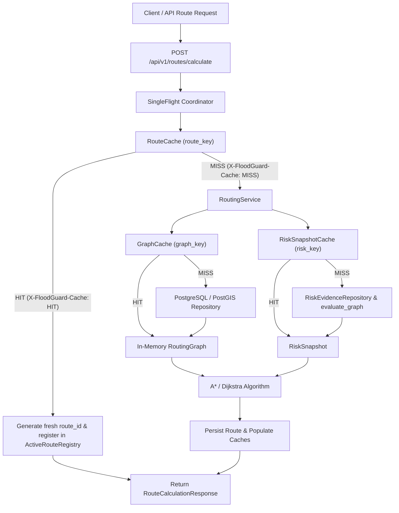

# FloodGuard Caching Architecture & Operational Guide (Phase 9)

## 1. Overview & Architecture

Phase 9 introduces Redis-backed cache-aside acceleration to FloodGuard without modifying the Phase 8 real-time invalidation and automatic rerouting event architecture.



### Core Invariant: Safety Above All
> [!IMPORTANT]
> **Stale risk must never produce a stale "safe" route.**
> 
> All cache keys for routes and risk evaluations embed the runtime `risk_revision`. Whenever an environmental simulation or sensor reading advances `risk_revision` (e.g. from `R0` to `R1`), all existing route cache keys automatically become cache misses without requiring expensive `KEYS` or `SCAN` invalidation scans.

---

## 2. Canonical Cache Keys

All cache keys adhere to the `floodguard:v1` namespace:

| Cache Domain | Canonical Pattern | Default TTL | Description |
| :--- | :--- | :--- | :--- |
| **Graph** | `floodguard:v1:graph:{graph_version_id}` | 86,400s (24h) | Immutable road topology graph and geometry. |
| **Route** | `floodguard:v1:route:{graph_version_id}:{source_node}:{dest_node}:{mode}:{algorithm}:{risk_revision}:{config_hash}` | 3,600s (1h) | Deterministic route calculation geometry and risk assessment. |
| **Risk** | `floodguard:v1:risk:{graph_version_id}:{risk_revision}:{config_hash}` | 3,600s (1h) | Deterministic edge risk snapshot for a graph version and risk revision. |

### Configuration Hash
The `config_hash` is an 8–12 character SHA-256 digest representing active penalty settings:
- `risk_balanced_penalty_seconds`
- `risk_safest_penalty_seconds`
- `risk_safest_unknown_penalty_seconds`
- `max_routing_expansions`

Any modification to risk penalty weights or expansion limits immediately alters `config_hash`, ensuring instant cache freshness across configuration updates.

---

## 3. Concurrency & Stampede Protection

To prevent cache stampedes (the "thundering herd" problem) where multiple concurrent requests for the same uncached route trigger redundant graph searches:
- A process-local **`SingleFlight`** coordinator (`app/cache/single_flight.py`) is keyed by calculation parameters.
- Only the leader coroutine executes the graph search and cache population.
- Concurrent sibling requests await the single execution's future, receiving the result without duplicate calculations.

---

## 4. Distinct Lifecycle Identity on Cache Hit

When a route calculation hits the cache:
1. Pure path coordinates, distances, ETAs, and edge risk assessments are retrieved from Redis.
2. A **distinct active route identity** (`route_id = uuid4()`) is generated.
3. The route is registered with `ActiveRouteRegistry` using the current `risk_revision`.
4. The HTTP response includes:
   - Header: `X-FloodGuard-Cache: HIT`
   - Payload: Complete `RouteCalculationResponse` with the newly assigned `routeId`.
5. The frontend subscribes to `GET /api/v1/routes/{routeId}/events` via Server-Sent Events identically to uncached routes.
6. When environmental events occur, the coordinator invalidates and reroutes the active route normally.

---

## 5. Graceful Degradation & Failure Modes

Redis is strictly treated as an ephemeral acceleration layer:
- **Redis Connection Loss**: All cache reads and writes catch network exceptions, log structured warnings, increment failure metrics, and fall back transparently to PostgreSQL/PostGIS. Routing never fails merely because Redis is unavailable.
- **Corrupt Cache Data**: Deserialization validation errors return `None` (cache miss) and log warnings without raising 500 errors to users.
- **Size Guards**: Graphs exceeding `graph_cache_max_bytes` (default: 50MB) are bypassed and not written to Redis, protecting memory limits.

---

## 6. Operational & Inspection Tools

### Cache Inspection
To inspect cached keys, memory usage, and TTLs without blocking Redis:
```bash
PYTHONPATH=backend backend/.venv/bin/python -m app.cache.inspect
```
*(Uses cursor `SCAN`, never `KEYS *`)*

### Safe Cache Invalidation
To clear cached keys matching the `floodguard:v1:*` pattern:
```bash
PYTHONPATH=backend backend/.venv/bin/python -m app.cache.clear
```
*(Uses cursor `SCAN` and batch `pipeline.delete()`. Never executes `FLUSHALL` or `FLUSHDB`)*

---

## 7. Metrics & Diagnostics

The cache layer provides structured metrics via `CacheMetrics`:
- **Domains Tracked**: `graph`, `route`, `risk`
- **Counters**: `hits`, `misses`, `sets`, `errors`, `bypassed`
- **Hit Ratio**: `hits / (hits + misses)`

