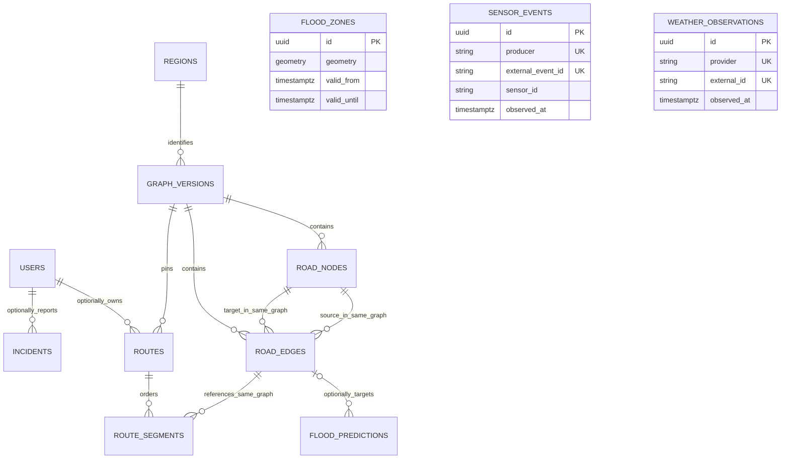

# FloodGuard database foundation

Phase 2 implements persistence only. The existing async SQLAlchemy 2.x/asyncpg engine and health contracts remain in place. Alembic owns domain DDL; neither API startup nor seed code calls `create_all`. The initial revision is `0001_database_foundation`. Full routing/event architecture remains in [system-design.md](system-design.md) and [events.md](events.md).

## Schema overview

| Table | Purpose | Spatial columns | Significant access paths |
| --- | --- | --- | --- |
| `users` | Future account persistence, no authentication | None | Unique normalized email |
| `regions` | Explicit geographic graph coverage | MultiPolygon `geometry` | Unique slug, coverage GiST |
| `graph_versions` | Identify a regional topology dataset | None | Unique `(region_id, version)` |
| `road_nodes` | Internal graph vertices with optional OSM provenance | Point `location` | Graph/OSM uniqueness; geometry and geography GiST |
| `road_edges` | Directed multigraph edges with static physical attributes | LineString `geometry` | Graph/source, graph/target, OSM segment/direction, GiST |
| `flood_zones` | Mutable named flood extents with validity/confidence | MultiPolygon `geometry` | GiST; validity interval |
| `sensor_events` | Append-oriented raw observations and source identity | Point `location` | Producer/event uniqueness; sensor/time; time; GiST |
| `weather_observations` | Normalized provider observations | Point `location` | Provider/event uniqueness; provider/location/time; time; GiST |
| `flood_predictions` | Future prediction output and model lineage | Nullable Point or MultiPolygon `geometry` | Edge/time; forecast time; GiST |
| `incidents` | Mutable reports and verification status | Point `location` | Status/time; reporter FK; GiST |
| `routes` | One saved, immutable calculation with graph/risk/policy labels | Point endpoints; LineString `geometry` | User/time; graph FK; expiry; route geometry GiST |
| `route_segments` | Ordered calculation-to-directed-edge associations | Referenced edge geometry | Unique route/sequence; edge/route |

`regions` and `graph_versions` are the two supporting tables anticipated by Phase 0. They enforce graph isolation now; import staging, activation pointers and routing remain later work. There are no risk snapshot, job, event inbox/outbox, authentication/session, or route revision tables yet.



Spatial overlap is a query, not a foreign key: zones, observations and incidents need not map to one road. Mermaid's `UK` labels on source identity fields denote the composite uniqueness described below, not individual uniqueness. ORM navigation exists only for `Route.segments`/`RouteSegment.route`, with `lazy="raise"`; large collections require an explicit query, and repositories never commit caller transactions.

## Identity and conventions

All internal primary keys are PostgreSQL UUIDs, matching Phase 0 public identity. Python generates UUIDv4 for ORM inserts; PostgreSQL `gen_random_uuid()` covers raw SQL inserts. This trades larger indexes than bigint for one identity convention across future API, workers and fixtures. Reassess only with measured graph-scale evidence. PostgreSQL 17 provides UUID generation in core, so neither pgcrypto nor uuid-ossp is required. See [PostgreSQL UUID functions](https://www.postgresql.org/docs/17/functions-uuid.html).

OSM IDs are separate nullable bigint source IDs, never primary keys. Synthetic/non-OSM records legitimately have null IDs. Node uniqueness is `(graph_version_id, osm_node_id)`; nulls remain distinct. Edge source identity is `(graph_version_id, osm_way_id, osm_segment_index, osm_direction)`. Way, segment ordinal and direction must either all be absent or all valid; direction is +1/-1 relative to source way ordering. A way can split into many edges and produce two directions. IDs repeat legitimately across graph versions.

Each edge represents one directed traversal. A bidirectional road will have two distinct edge rows with reversed endpoints and oriented LineStrings. `is_one_way` records source-road provenance; false does not instruct a search to invent a reverse edge. Parallel roads remain distinct. Self-loops are rejected in this foundation. Nonnegative finite distance/time accepts zero to meet persistence requirements; future import validation must reject unusable zero-length artifacts and check geometry/endpoints and computed length consistency before graph activation.

Constraint names are generated by one stable SQLAlchemy metadata naming convention, with explicit names for composite graph FKs. UUID primary-key indexes and `(id, graph_version_id)` unique constraints coexist where PostgreSQL requires an exact composite referenced key. These are intentional referential-integrity indexes, rather than redundant secondary indexes added for UUID lookup.

Email is unique after the application trims surrounding whitespace and lowercases the whole address. The database rejects noncanonical stored values and empty/basic malformed addresses; future input validation will enforce full email syntax. This product treats email casing as insignificant, including the local part. Unicode/domain normalization and identity-provider issuer/subject linkage belong to the authentication phase. Roles and bounded statuses use varchar plus CHECK constraints, making additions explicit reviewed constraint migrations without native enum lifecycle complexity. There are no password fields.

All instants use `timestamptz`; scripts use timezone-aware UTC values. `created_at` records creation for users, topology, zones, predictions and incidents. `updated_at` exists for users, zones and incidents; a migration-managed trigger uses `clock_timestamp()` on UPDATE, including raw SQL writes. Observations use `observed_at`/`received_at`, routes use `calculated_at`, and immutable segment associations have no cosmetic timestamps.

## Spatial strategy

All 11 stored spatial columns are 2D `geometry(...,4326)`. Coordinates are longitude then latitude. Nodes, sensors, weather and incidents are Points; edges and saved paths are LineStrings; zones and regional coverage are MultiPolygons so disconnected real extents fit one record. Prediction geometry is `geometry(Geometry,4326)` restricted by CHECK to Point or MultiPolygon, nullable when an edge target exists. A prediction must have at least geometry or `road_edge_id`, and may have both.

Typed geometry preserves native GiST bounding-box, intersection and containment operations and supports direct map serialization. Database checks reject invalid, empty and out-of-range WGS84 geometries; typmods reject incorrect SRIDs/types/dimensions. Setting SRID labels coordinates; transforming another coordinate system requires `ST_Transform`, not merely `ST_SetSRID`.

Use `geometry` for `ST_Intersects`/`ST_Covers` and bounding-box lookup. Cast to `geography` for `ST_DWithin`/`ST_Distance` in meters or `ST_Length` in spheroidal meters. A node GiST expression index on `(location::geography)` matches the planned bounded meter-radius lookup. Geometry in SRID 4326 has degree units, so `ST_DWithin(geometry, geometry, 150)` would not mean 150 meters. No manual latitude/longitude distance formula is used. See [PostGIS ST_DWithin](https://postgis.net/docs/ST_DWithin.html) and [ST_Length](https://postgis.net/docs/ST_Length.html).

No geography columns are duplicated in storage. Additional geography expression indexes for other observations will be added when an implemented proximity workload warrants their write cost. The verifier reads declared PostGIS typmods from `pg_attribute`; `geometry_columns` can infer a narrower prediction type from a subtype CHECK and is insufficient to verify a generic mixed-type column.

## Index strategy

The migration explicitly creates 25 secondary indexes: 10 GiST and 15 B-tree. GeoAlchemy's automatic spatial-index creation is disabled to prevent duplicated DDL. The following inventory explains every secondary index; primary keys and unique constraints create their own B-tree indexes.

| Index | Type | Intended query |
| --- | --- | --- |
| `ix_regions_geometry` | GiST | Point/viewport coverage candidates |
| `ix_road_nodes_location` | GiST | Map bounding boxes and geometry lookup |
| `ix_road_nodes_location_geography` | GiST expression | Bounded road-node radius in meters |
| `ix_road_edges_geometry` | GiST | Road/flood intersection and viewport candidates |
| `ix_road_edges_graph_source` | B-tree | Directed adjacency per graph/source; composite FK maintenance |
| `ix_road_edges_graph_target` | B-tree | Incoming-edge lookup per graph/target; composite FK maintenance |
| `ix_flood_zones_geometry` | GiST | Point coverage and road/extent intersection |
| `ix_flood_zones_validity` | B-tree | Valid-from ranges with valid-until filtering; not a universal interval-search index |
| `ix_sensor_events_location` | GiST | Geographic observation/viewport selection |
| `ix_sensor_events_sensor_observed` | B-tree | One sensor's recent history (`observed_at DESC`) |
| `ix_sensor_events_observed_at` | B-tree | Cross-sensor observation windows and future retention |
| `ix_weather_observations_location` | GiST | Geographic weather observation lookup |
| `ix_weather_observations_observed_at` | B-tree | Cross-provider recent observation windows and retention |
| `ix_weather_observations_provider_location_observed` | B-tree | Latest provider/station-or-cell observations |
| `ix_flood_predictions_geometry` | GiST | Area/point prediction intersection candidates |
| `ix_flood_predictions_predicted_for` | B-tree | Regional forecast-time windows |
| `ix_flood_predictions_edge_predicted` | B-tree | A road edge's forecast history and FK maintenance |
| `ix_incidents_location` | GiST | Incident viewport/intersection lookup |
| `ix_incidents_status_occurred` | B-tree | Recent unresolved/verified status filters |
| `ix_incidents_reporter` | B-tree | Reporter lookup and account deletion FK maintenance |
| `ix_routes_geometry` | GiST | Saved-path spatial lookup; endpoints have no unused GiST indexes |
| `ix_routes_user_calculated` | B-tree | Owner calculation history (`calculated_at DESC`) and FK maintenance |
| `ix_routes_graph_version_id` | B-tree | Graph-reference retention/FK maintenance |
| `ix_routes_expires_at` | B-tree | Future expiry/retention selection |
| `ix_route_segments_edge_route` | B-tree | Edge-to-calculation lookup and edge FK maintenance |

Unique email, region slug, region/version, graph/OSM node, graph/OSM edge identity, producer/event, provider/external ID and route/sequence constraints already provide indexes. In particular `(route_id, sequence)` supports route lookup and ordering, so there is no extra route-ID index. The graph/OSM node index already supports graph-only node selection. There are no speculative JSONB GIN indexes, partitioning, sharding or BRIN indexes.

`EXPLAIN (ANALYZE, BUFFERS)` is run on the synthetic meter-radius query with the natural plan and again with transaction-local `enable_seqscan=off`. The latter proves structural GiST eligibility only. Tiny fixture data can favor sequential scans; neither plan establishes a production speedup. See [phase-2-verification.md](verification/phase-2-verification.md) for executed evidence.

## Constraints, units and prediction lineage

Risk scores, prediction probabilities and confidence are in [0,1]. Physical distance/time/rain/depth/wind values are finite and nonnegative; present speed limits are finite and strictly positive. Elevation, temperature and generic sensor value may be negative but must be finite. Checks explicitly reject NaN/infinity where applicable. Humidity is in [0,100], segment sequences are nonnegative, and graph versions/forecast horizons/weather intervals are positive.

Zone validity, route expiry, prediction expiry and incident verification have ordered-time checks. Observation timestamps are not constrained to precede receipt: device clock skew and late arrival must be diagnosed by future quality handling without losing raw evidence. Sensor `unit` accompanies `value`; normalized rainfall is millimeters, water depth centimeters, wind meters/second, speed kilometers/hour, distance meters and travel time seconds. Weather rainfall is accumulation over `observation_interval_minutes`, not intensity; an absent interval means unknown and must not be inferred downstream.

Prediction `model_name`, `model_version`, `feature_version`, horizon and `predicted_for` are required normalized fields; optional expiry and edge/geometry targets preserve output context. The fixture's model is explicitly synthetic, with no inference. A future prediction phase will add normalized feature cutoff/dataset lineage and model-registry FKs as those contracts become concrete. Model/policy labels on routes remain opaque strings until the authoritative risk-snapshot/model tables are introduced.

Dynamic risk is separate from `road_edges`: observations, zones, predictions and incidents are evidence; the future risk engine publishes immutable eligibility/weight snapshots. Persisted route risk is a calculation's historical summary, not current live edge risk. No risk engine or edge-cost calculation is implemented here.

## Deduplication and JSONB

Sensor uniqueness is the required, nonempty `(producer, external_event_id)` pair. Stable source IDs survive retries; different producers may legitimately use the same external ID. Sensor registration will later scope these identities and authorize producers. The sensor repository performs atomic `INSERT ... ON CONFLICT DO NOTHING` and returns an inserted UUID or null. It does not update existing observations or publish events. Future ingestion must compare payloads when an identity is reused with conflicting content and write its outbox in the same transaction. This uniqueness protects raw storage, not downstream exactly-once effects; per-consumer inbox/outbox remain later work.

Weather uniqueness is `(provider, external_id)` with both required. Adapters without provider IDs must construct a stable provider/station-or-cell/observation-window identity; do not mint random retry IDs. `location_key` supports provider-specific recent history. Source business identity and any future broker/domain event UUID remain separate.

SQL `metadata` columns map to Python `attributes`, avoiding SQLAlchemy's reserved `metadata` attribute. JSONB holds external road tags, provenance and fixture annotations; weather `raw_data` retains provider-specific fields. Core coordinates, relationships, timings, measured values, risk and model versions are relational columns. JSONB is not a replacement for those fields, and no current query needs a GIN index.

## Relationships, deletes and retention

Composite edge/node FKs enforce matching graph versions. Composite segment/route and segment/edge FKs enforce that a saved calculation uses edges from its own graph. Routes preserve sequence and physical distance/time/risk per segment, making historical edge linkage explicit. No route algorithm, geometry reconstruction service or invalidation workflow is present.

| Delete | Database behavior | Reason |
| --- | --- | --- |
| Route | CASCADE its segments | Segments belong only to that calculation |
| User | SET NULL on route owner and incident reporter | Preserve calculation/report evidence; future privacy policy controls other identifying text |
| Referenced node | RESTRICT | Do not break topology |
| Referenced edge | RESTRICT via segments/predictions | Do not lose historical path/model targets |
| Referenced graph version | RESTRICT | Preserve topology/calculation lineage |
| Referenced region | RESTRICT | Preserve graph coverage lineage |

Users, zones and incident workflow state are mutable. Observations/predictions are append-oriented; topology is versioned and saved calculations/segments are immutable by service convention. Phase 2 does not install blanket UPDATE-denial triggers or account authorization. Later services must enforce publication/immutability and use a new graph version rather than editing active topology.

The Phase 0 stable journey head/current-revision ownership protocol is not yet exposed. Phase 2 `routes` represents a calculation and permits nullable users for synthetic or anonymous future persistence. Before public route access, add scoped anonymous ownership and `route_revisions`, migrating ordered segments to the revision contract. A UUID or null owner confers no authorization.

Proposed retention: ephemeral anonymous calculations expire quickly (initial candidate 24 hours), user history follows explicit product/privacy policy, and subscribed journeys retain their current/required prior revisions. Later cleanup must delete expired route records in batches, which cascades segments, then retire unreferenced graph versions. Observation/prediction retention must cover operational analysis, approved training and supported replay/deduplication windows; archive before any justified deletion. Do not remove source dedupe identities while supported retries can return. These are future policy considerations, not implemented jobs or guaranteed durations.

## Migrations and commands

Migration configuration follows Alembic's [asyncio connection-sharing pattern](https://alembic.sqlalchemy.org/en/latest/cookbook.html#using-asyncio-with-alembic). It reads the existing `DATABASE_URL` through Settings; credentials are not embedded in alembic.ini or logged. Migration privileges must permit PostGIS creation on a fresh database; future managed environments should provision this through a controlled migration identity.

The upgrade creates only required `postgis`, all domain tables/constraints/indexes and three timestamp triggers. Existing initialization SQL remains a Phase 1 infrastructure bootstrap. The migration independently ensures PostGIS, so a database created from template0 works without Docker initialization. The pinned image's own initialization may also enable raster in its default database; FloodGuard neither requires nor adds it. Downgrade removes application tables/triggers/function in dependency order and intentionally retains shared PostGIS and its objects. It must never drop the extension with CASCADE.

From the root, normal development flow:

```sh
docker compose up --build -d --wait --wait-timeout 180
docker compose exec backend uv run --locked alembic upgrade head
docker compose exec backend uv run --locked python -m app.db.seed
docker compose exec backend uv run --locked python -m app.db.verify
docker compose exec backend uv run --locked alembic current --check-heads
docker compose exec backend uv run --locked alembic check
```

With reachable host PostgreSQL, the equivalent commands from `backend/` are `uv run --locked alembic upgrade head`, `uv run --locked python -m app.db.seed` and `uv run --locked python -m app.db.verify`. Seed is development/test only, transactional, advisory-lock serialized, uses deterministic UUIDv5 fixture IDs and fixed UTC times, and inserts missing primary keys without overwriting existing rows. A repeat inserts zero rows. Conflicting unrelated natural keys fail atomically. Reserve these fixture IDs and do not edit them as real operational data.

The seed contains one user, region and graph version; four A/B/C/D nodes; eight directed edges for four bidirectional links; one zone, sensor event, weather observation, prediction, incident and saved synthetic route; and two ordered segments for A→B→D (23 rows). Edge meters are computed by PostGIS. The path and risk are manually authored fixtures, explicitly marked as not engine output. Fixed validity dates make this fixture historical; verification uses fixture coordinates, not current flood conditions.

The verifier checks connectivity/PostGIS, migration head, all expected tables, validated constraints, valid indexes, declared spatial SRIDs/types, exact fixture IDs/counts, meter-radius lookup, road/zone intersection, point containment, ordered segments and index eligibility. It neither changes domain records nor depends on seed for readiness. Exit failure means verification failed.

For reproducible clean-storage integration tests, use the separate Compose project with no published ports or development data mounts:

```sh
docker compose -f docker-compose.database-test.yml up -d --wait postgres-test
docker compose -f docker-compose.database-test.yml run --rm --build database-check
docker compose -f docker-compose.database-test.yml down
```

Its PostgreSQL data directory is a 256 MiB tmpfs, removed with that test container. Tests mint random `floodguard_test_<uuid>` databases from template0, run real migrations and rollback each fixture transaction. The round-trip test upgrades, seeds/verifies, downgrades to base, confirms no application tables/function remain, upgrades again, checks schema drift and reseeds/verifies. Cleanup drops only database names minted by that process; the test role needs CREATEDB and extension privileges. Existing development data is untouched. No SQLite substitution is used.

With an already running PostGIS development stack, `RUN_INTEGRATION_TESTS=1 uv run --locked pytest -q -m integration` also works when its role has those test privileges, alongside Phase 1 PostgreSQL/Redis/API checks. Without opt-in, integration tests skip explicitly. MacOS/Colima localhost forwarding remains Phase 1 technical debt; use the Docker-network commands until the runtime is repaired.

## Phase 4 graph population

The Phase 4 local OSM importer populates the existing `regions`, `graph_versions`, `road_nodes` and `road_edges` tables; it does not add or rewrite schema migrations. Each import creates a new graph version, keeps UUID primary keys separate from OSM IDs, and stores the source filename/checksum in graph-version metadata. A bidirectional way becomes two directed edge rows with reversed endpoints and geometry. OSM way identity, segment index and direction are scoped by graph version through the existing uniqueness constraint. Re-importing the same source checksum for a region is rejected rather than duplicated. See [osm-ingestion.md](osm-ingestion.md) for filtering, speed assumptions, validation and CLI usage.
