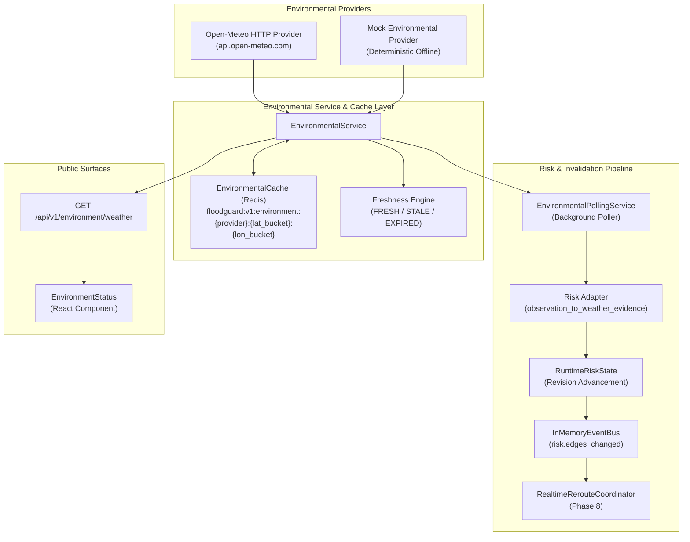

# FloodGuard Environmental Data Adapter Layer (Phase 10)

## 1. Overview & Architecture

Phase 10 introduces a provider-agnostic environmental data adapter layer that enables FloodGuard to consume real-world weather and rainfall observations. It bridges external meteorological providers to the existing Phase 6 deterministic risk scoring engine and Phase 8 real-time route invalidation pipeline without altering routing logic.



---

## 2. Core Architectural Principles

1. **Provider Independence**: Core routing, deterministic simulation, and risk scoring remain decoupled from specific weather provider APIs.
2. **Offline First**: All automated unit and regression tests run completely offline using `MockEnvironmentalProvider` without requiring internet connectivity.
3. **Critical Semantic Invariant: Missing vs. Zero Rainfall**:
   > [!IMPORTANT]
   > `rainfall_mm_per_hour = None` means the provider did **not** supply rainfall (MISSING).  
   > `rainfall_mm_per_hour = 0.0` means an explicit observation of **no rain** (ZERO).  
   > These two states are never conflated or coerced anywhere in the FloodGuard pipeline.
4. **Security & Privacy**: API keys (e.g. for enterprise weather tiers) are configured via Pydantic `SecretStr` and are never exposed in logs, HTTP responses, Redis cache keys, or client-facing payloads.

---

## 3. Normalized Domain Model

The canonical model is defined in `app.environment.models.EnvironmentalObservation`:

```python
@dataclass(frozen=True)
class EnvironmentalObservation:
    provider: str                      # Short provider id ('open_meteo', 'mock')
    external_id: str                   # Deterministic deduplication id
    latitude: float                    # WGS-84 decimal degrees
    longitude: float                   # WGS-84 decimal degrees
    observed_at: datetime              # Timestamp of actual measurement (UTC)
    received_at: datetime              # Timestamp of ingestion by FloodGuard (UTC)
    rainfall_mm_per_hour: float | None # None = MISSING; 0.0 = NO RAIN
    temperature_c: float | None        # Air temperature in °C
    humidity_percent: float | None     # Relative humidity 0–100%
    wind_speed_mps: float | None       # Wind speed in m/s
    source_quality: str                # Quality indicator ('good', 'estimated')
    data_source_state: DataSourceState # LIVE, CACHE_FRESH, CACHE_STALE, MOCK
    raw_metadata: dict[str, Any] | None# Debug metadata (never serialized to clients)
```

### Data Source & Freshness States
- **DataSourceState**:
  - `LIVE`: Fresh data obtained directly from provider API.
  - `CACHE_FRESH`: Retrieved from Redis cache within the freshness window.
  - `CACHE_STALE`: Retrieved from Redis cache after provider failure, within expiration limit.
  - `MOCK`: Generated by the deterministic mock provider for testing/development.
  - `UNAVAILABLE`: Provider failed and no cached observation is available.
- **FreshnessState**:
  - `FRESH`: Age $\le 600\text{s}$ (10 minutes).
  - `STALE`: Age between $600\text{s}$ and $3600\text{s}$ (1 hour).
  - `EXPIRED`: Age $> 3600\text{s}$ (1 hour).

---

## 4. Providers

### Open-Meteo Provider (`OpenMeteoProvider`)
- **API Endpoint**: `https://api.open-meteo.com/v1/forecast`
- **Fields Ingested**:
  - `precipitation` $\rightarrow$ `rainfall_mm_per_hour` (preserves `null` as `None` vs `0.0`)
  - `temperature_2m` $\rightarrow$ `temperature_c`
  - `relative_humidity_2m` $\rightarrow$ `humidity_percent`
  - `wind_speed_10m` $\rightarrow$ `wind_speed_mps`
- **Reliability & Retry Policy**:
  - Maximum 3 attempts with exponential back-off and randomized jitter.
  - Automatically respects HTTP `429` `Retry-After` header.
  - Immediate fail without retry on HTTP `401`/`403`.
  - Range validation rejects corrupt responses (negative precipitation, humidity $> 100\%$).

### Mock Environmental Provider (`MockEnvironmentalProvider`)
- Configurable deterministic observations for offline development, integration tests, and reproducible benchmarks.
- Supports failure simulation (`force_failure=True`), timeouts (`force_timeout=True`), and artificial staleness (`stale_hours > 0`).

---

## 5. Cache & Spatial Bucketing

Environmental observations are cached in Redis under the `floodguard:v1:environment` namespace:

$$\text{Key Pattern: } \texttt{floodguard:v1:environment:\{provider\}:\{lat\_bucket\}:\{lon\_bucket\}}$$

### Geographic Bucketing (`location_bucket`)
Coordinates are rounded to 2 decimal places:
$$\text{Bucket: } \text{round}(\text{lat}, 2) : \text{round}(\text{lon}, 2)$$
This maps queries into an approximately $1.1\text{ km} \times 1.1\text{ km}$ grid, maximizing cache hits for adjacent requests while retaining hyper-local granularity.

---

## 6. Risk Engine & Polling Integration

### Risk Adapter (`observation_to_weather_evidence`)
Converts `EnvironmentalObservation` into `app.risk.models.WeatherEvidence`:
- If `rainfall_mm_per_hour is None`: returns `None` (missing data is never converted into fake 0.0 rain).
- If `rainfall_mm_per_hour is not None`: maps to `WeatherEvidence(rainfall_mm=..., observed_at=..., observation_interval_minutes=60)`.

### Polling Service (`EnvironmentalPollingService`)
- Disabled by default (`weather_polling_enabled = False`).
- Polls configured coordinates at regular intervals (`weather_polling_interval_seconds = 300.0`).
- **Materiality Threshold**: Triggers a risk revision advance only when rainfall changes by $\ge 0.5\text{ mm/h}$ or on first non-zero rain detection.
- Emits `risk.edges_changed` on the internal event bus to notify `RealtimeRerouteCoordinator` of active route impacts.

---

## 7. Configuration Settings

| Setting | Type | Default | Description |
| :--- | :--- | :--- | :--- |
| `ENVIRONMENT_PROVIDER` | `str` | `"mock"` | Provider to use (`"mock"` or `"open_meteo"`). |
| `WEATHER_API_KEY` | `SecretStr` | `None` | Optional API key for enterprise weather endpoints. |
| `WEATHER_API_BASE_URL` | `str` | `"https://api.open-meteo.com"` | Weather API base URL. |
| `WEATHER_REQUEST_TIMEOUT_SECONDS` | `float` | `5.0` | HTTP request timeout. |
| `WEATHER_CACHE_TTL_SECONDS` | `int` | `300` | Redis observation cache TTL (5 minutes). |
| `WEATHER_POLLING_ENABLED` | `bool` | `False` | Enable background polling service. |
| `WEATHER_POLLING_INTERVAL_SECONDS` | `float` | `300.0` | Interval between background polling ticks. |
| `WEATHER_FRESHNESS_FRESH_SECONDS` | `int` | `600` | Freshness window threshold (10 minutes). |
| `WEATHER_FRESHNESS_STALE_SECONDS` | `int` | `3600` | Stale window threshold (1 hour). |

