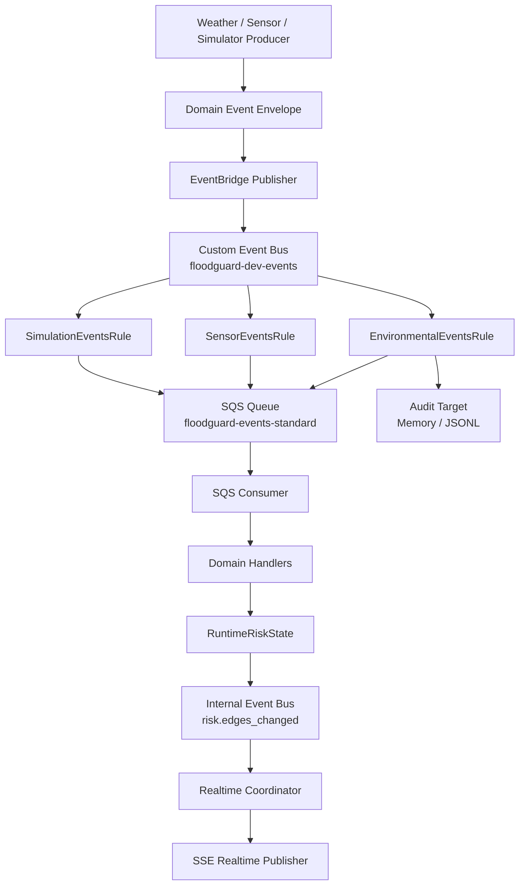

# Phase 15 — AWS EventBridge Event Routing & Fan-Out

FloodGuard uses **AWS EventBridge** as its event routing and fan-out layer. EventBridge routes domain events to one or more downstream targets (like SQS queues or audit sinks) based on event type and metadata.

## 1. Architecture



**Key Invariants:**
1. **EventBridge routes; SQS processes durably.** EventBridge does not replace SQS.
2. **EventBridge acceptance does NOT mean downstream processing succeeded.**
3. **Domain event identity survives every transport hop.** The same `eventId` and `correlationId` make it end-to-end.
4. **Redis idempotency remains authoritative** for deduplicating identical deliveries.
5. **EventBridge never replaces SSE for browser delivery.**

## 2. Event Bus & Configuration

EventBridge is enabled via the `EVENT_TRANSPORT` mode.

```env
EVENT_TRANSPORT=EVENTBRIDGE
EVENTBRIDGE_ENABLED=true
EVENTBRIDGE_BUS_NAME=floodguard-dev-events
EVENTBRIDGE_SOURCE=com.floodguard
AWS_REGION=ap-south-1
```

- **Source**: `com.floodguard`
- **Bus**: `floodguard-dev-events` (namespaced by environment)
- **DetailType**: The underlying canonical domain event type (e.g. `environment.weather_observed`)

## 3. Rules & Targets

| Rule | Pattern | Target |
| --- | --- | --- |
| `floodguard-v1-environment-events` | `source: ["com.floodguard"], detail-type: ["environment.weather_observed"]` | SQS Queue + Audit Sink |
| `floodguard-v1-sensor-events` | `source: ["com.floodguard"], detail-type: ["sensor.water_depth_observed", "sensor.health_changed"]` | SQS Queue |
| `floodguard-v1-simulation-events` | `source: ["com.floodguard"], detail-type: ["simulation.event_emitted"]` | SQS Queue |

These rules are explicitly isolated. A sensor event will not match the environment rule and will not be sent to the audit sink. Unsupported events are accepted by the bus but not routed to the processing SQS queue.

## 4. Fan-Out & Partial Failure Semantics

**Fan-Out**: An event published to EventBridge can be routed to multiple targets. If the `environment.weather_observed` event is published, both the SQS processing queue and the Audit sink receive it independently.

**Partial Batch Failure**: `EventBridgeEventPublisher.publish_batch` groups up to 10 entries per API request. EventBridge's `PutEvents` can return partial success (some entries succeed, some fail). The publisher parses `FailedEntryCount` and `Entries` to return an item-level result for each event.

**Target Failure Independence**: Failure to deliver to one target (e.g. the audit sink) does not block delivery to another target (e.g. the SQS queue).

## 5. EventBridge-to-SQS Adapter

When EventBridge routes an event to an SQS queue, the message body is wrapped in an outer EventBridge JSON envelope. The `EventBridgeSqsMessageAdapter` handles unwrapping this transparently:

1. Detects outer EventBridge envelope (checking for `"detail"` and `"source"`).
2. Deserializes the inner canonical `TransportEnvelope`.
3. Preserves `EventBridge event_id` separately for logging.
4. If a direct Phase 14 SQS message is received (no outer envelope), it falls back to parsing it directly, maintaining 100% backward compatibility.

## 6. Local Testing & AWS Credentials

All core EventBridge logic is covered by the `InMemoryEventBridge` emulator. It strictly emulates:
- Custom busses, rules, patterns, and targets.
- PutEvents limits and partial batch failures.
- Fan-out target failure independence.

No AWS account is required for the automated test suite.

## 7. Idempotency & Ordering

**Duplicate Result**: EventBridge does not guarantee exactly-once delivery. When duplicate deliveries happen via EventBridge into SQS, the Redis `RedisIdempotencyStore` catches the duplicate `eventId`, resulting in only **1 logical mutation**.

**Out-of-Order Result**: SQS Standard and EventBridge do not guarantee ordering. The `occurredAt` timestamp is the high-water mark for risk state. A newer event updates the state; a subsequently received older event does not regress the state.

## 8. IAM Requirements

### Producer
Requires `events:PutEvents` scoped to the specific custom bus.
```json
{
  "Effect": "Allow",
  "Action": "events:PutEvents",
  "Resource": "arn:aws:events:REGION:ACCOUNT:event-bus/floodguard-dev-events"
}
```

### EventBridge Service
Requires permission to send to the target SQS queue.
```json
{
  "Effect": "Allow",
  "Principal": { "Service": "events.amazonaws.com" },
  "Action": "sqs:SendMessage",
  "Resource": "arn:aws:sqs:REGION:ACCOUNT:floodguard-dev-events-standard",
  "Condition": {
    "ArnEquals": {
      "aws:SourceArn": "arn:aws:events:REGION:ACCOUNT:rule/floodguard-dev-events/floodguard-v1-*"
    }
  }
}
```

## 9. Limitations
- Does not implement full DLQ/redrive (Targeted for Phase 16).
- Audit target is memory-only; S3 sink is not implemented yet.
- AWS Cross-account routing is not configured.
- No archive/replay configured natively in EventBridge.

