# System Limitations & Future Engineering Roadmap

This document outlines the architectural trade-offs, operational boundaries, and planned engineering enhancements for **FloodGuard**.

---

## 1. Current System Limitations & Engineering Trade-offs

### 1.1 Geospatial & Graph Routing
* **Regional vs. Continental Scale:** The routing engine is verified on regional road graphs (e.g., Kerala OpenStreetMap network: 7,882 nodes, 18,348 directed edges). Expanding to continental or global scales (hundreds of millions of edges) will require pre-computed **Customizable Contraction Hierarchies (CCH)** or hierarchical multi-level graph partitioning (e.g., KaHIP) to maintain sub-second pathfinding latencies.
* **Vehicle Profile Granularity:** Edge traversability is currently modeled as a single scalar cost penalty based on passenger vehicle thresholds ($> 30\text{ cm}$ water depth = impassable). It does not yet account for vehicle-specific clearance profiles (e.g., high-clearance military/emergency 4x4s, heavy rescue vehicles, or low-slung electric vehicles with vulnerable battery packs).
* **Micro-Topographic Drainage:** Edge elevations are derived from Digital Elevation Models (DEM). While elevation and slope are captured, micro-drainage anomalies (such as blocked storm drains, burst water mains, or temporary roadside sandbag barriers) cannot be detected without dedicated localized sensor placement or manual incident reports.

### 1.2 Machine Learning & Environmental Sensing
* **Synthetic Training Baseline:** The current XGBoost flood prediction model was trained and evaluated on synthetic physical simulations combined with regional topography (`SYNTHETIC DATASET EVALUATION`). Live historical archive ingestion from real-world Doppler radar (NEXRAD) and multi-year municipal flood archives is required before declaring field operational deployment.
* **Sparse Sensor Grid Interpolation:** In areas lacking IoT depth sensors, the model estimates water risk using upstream rainfall accumulations and topographic slope. While physically grounded, localized water ponding on flat micro-basins may have higher variance without ground-truth sensors.
* **Sensor Outage Tolerance:** While the system gracefully handles sensor dropouts by lowering edge confidence scores and falling back to physical elevation rules, prolonged telemetry outages in an entire sub-basin force reliance on static rainfall forecasts.

### 1.3 Client Telemetry & Battery Consumption
* **Persistent SSE Streaming:** Real-time route invalidation uses Server-Sent Events (SSE) over HTTP/2. While efficient for web dashboards and in-vehicle head units, running persistent SSE connections on background mobile devices can impact battery longevity. Transitioning to hybrid Push Notifications (APNs / FCM) for background states is required for mobile battery optimization.

---

## 2. Future Engineering Roadmap

```mermaid
flowchart LR
    subgraph PhaseI["Phase 1: Scale & Profiles (Q1)"]
        direction TB
        A["Contraction Hierarchies (CCH)"]
        B["Vehicle Clearance Profiles\n(EV, 4x4, Ambulance)"]
    end

    subgraph PhaseII["Phase 2: Earth Observation (Q2)"]
        direction TB
        C["Sentinel-1 SAR Satellite Feeds"]
        D["Computer Vision Water Extents"]
    end

    subgraph PhaseIII["Phase 3: Deep AI & Flow (Q3)"]
        direction TB
        E["Spatio-Temporal GNNs"]
        F["Hydrodynamic Water Inundation"]
    end

    subgraph PhaseIV["Phase 4: Disaster Resilience (Q4)"]
        direction TB
        G["Offline Mesh P2P Routing\n(BLE / Wi-Fi Direct)"]
        H["Multimodal Evacuation Corridors"]
    end

    PhaseI --> PhaseII --> PhaseIII --> PhaseIV
```

### Phase 1: Scale & Vehicle Profiles (Q1)
* **Customizable Contraction Hierarchies (CCH):** Implement CCH graph preprocessing to enable instant dynamic metric updates (flood penalty modifications) across multi-million node graphs in under 50ms without full Dijkstra/A* relaxation.
* **Dynamic Vehicle Profiles:** Enable drivers and emergency dispatchers to specify vehicle dimensions, exhaust heights, and ground clearance (e.g., Sedans: 15cm limit, SUVs: 30cm limit, Fire Trucks: 60cm limit).
* **Multi-Modal Route Export:** Support GPX, GeoJSON, and KML export formats directly into municipal emergency dispatch systems (CAD / GIS).

### Phase 2: Earth Observation & Satellite Fusion (Q2)
* **Synthetic Aperture Radar (SAR) Ingestion:** Ingest Sentinel-1 SAR and radar satellite imagery. Because radar penetrates clouds and rain, automated segmentation pipelines can extract flood inundation polygons during active cloudbursts.
* **Crowdsourced Photo Validation:** Integrate computer vision (YOLO / Vision Transformers) on crowdsourced incident photos to estimate water depth from visual markers (e.g., tire submersion, curb height).

### Phase 3: Spatio-Temporal Graph Neural Networks (Q3)
* **Deep Hydrodynamic Modeling:** Replace static tabular prediction with a **Spatio-Temporal Graph Neural Network (ST-GNN)** that models flood water flow across physical elevation gradients and road topologies over time.
* **Predictive Horizon Rerouting:** Instead of reacting only to current water levels, predict road inundation 30–60 minutes ahead, preemptively rerouting long-distance journeys before roads become submerged.

### Phase 4: Disaster-Zone Edge Resilience (Q4)
* **Offline-First P2P Mesh Routing:** During catastrophic natural disasters, cellular base stations and power grids often fail. Develop an edge-first mobile client capable of computing local A* routes fully offline and exchanging road hazard warnings device-to-device via Bluetooth Low Energy (BLE) and Wi-Fi Direct mesh protocols.
* **Multimodal Evacuation Corridors:** Extend pathfinding beyond public roads to include pedestrian footpaths, designated high-ground assembly zones, and boat/amphibious rescue corridors.

