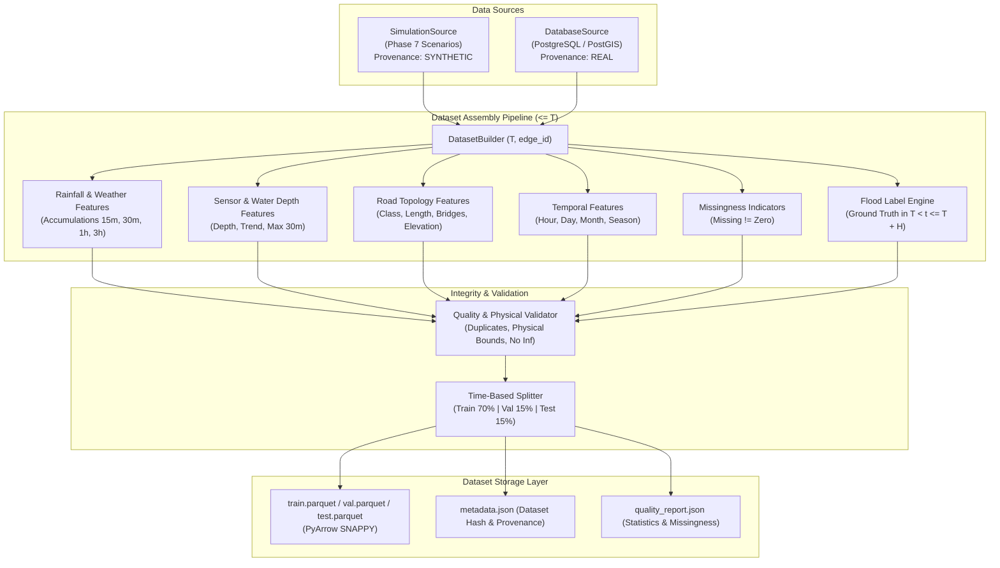

# FloodGuard ML Dataset & Feature Engineering Pipeline (Phase 11)

## 1. Overview & Architecture

Phase 11 introduces a code-driven, reproducible data pipeline that transforms environmental observations, road topology, sensor readings, and ground-truth flood occurrences into tabular ML-ready datasets for training predictive flood models (Phase 12).



---

## 2. Prediction Objective & Unit

### Prediction Unit
The unit of observation is a **road edge at a specific timestamp**:
$$\text{Record Key} = (\text{edge\_id}, T)$$

Features describe environmental and road conditions at or before time $T$ ($t \le T$).

### Prediction Target
- **Target Column**: `target_flooded_within_horizon` (binary: `0` or `1`).
- **Objective**: Predict whether road edge $X$ will experience a **HIGH** or **SEVERE** flood state within the next $H$ minutes ($T < t \le T + H$).
- **Configurable Horizon**:
  - Default: `prediction_horizon_minutes = 30` ($H = 30$).
  - Evaluated condition in $(T, T + H]$:
    1. Sensor water depth $\ge 15.0\text{ cm}$ (configurable threshold), OR
    2. Active flood zone overlapping edge with severity in `{"HIGH", "SEVERE"}`, OR
    3. Active incident on edge with severity in `{"HIGH", "SEVERE"}`.

---

## 3. Critical Invariants

### Invariant 1: Zero Future Information Leakage
- **Contract**:
  $$\text{Features} \le T < \text{Prediction Horizon} \le T + H$$
- Observations, sensor readings, and weather measurements with timestamps $> T$ are strictly filtered out before feature aggregation.
- Labels only evaluate ground truth events occurring strictly in $(T, T + H]$.
- Automated regression tests verify that future rainfall/depth spikes do not alter features at $T$.

### Invariant 2: Missing Data $\ne$ Zero Rainfall
- `rainfall_rate_now_mm_h = 0.0`: explicit observation of dry weather.
- `rainfall_rate_now_mm_h = None`: missing sensor or provider observation.
- Explicit boolean flags (`is_rainfall_missing`, `is_water_depth_missing`, `is_temperature_missing`) are preserved to prevent loss of missingness signal. Imputation is deferred to Phase 12 model preprocessing.

### Invariant 3: Source Provenance (Synthetic $\ne$ Real)
- Every dataset records its provenance:
  - `SYNTHETIC`: generated from Phase 7 simulator scenarios (reproducible, offline testing).
  - `REAL`: extracted from production PostGIS tables and verified observations.
  - `MIXED`: combined sets with row-level tracking.
- Synthetic data is never presented as real historical flood data.

---

## 4. Feature Schema V1

The dataset schema is defined in `FeatureSchemaV1` (`FEATURE_VERSION = "v1"`):

| Feature Name | Type | Unit | Nullable | Source | Contract | Description |
| :--- | :--- | :--- | :--- | :--- | :--- | :--- |
| `edge_id` | string | ID | No | metadata | $\le T$ | Road edge identifier |
| `observation_time` | string | ISO-8601 | No | metadata | $\le T$ | Observation timestamp $T$ |
| `prediction_horizon_minutes` | int64 | minutes | No | metadata | $\le T$ | Prediction horizon $H$ |
| `source_type` | string | enum | No | metadata | $\le T$ | Data provenance (`SYNTHETIC`, `REAL`, `MIXED`) |
| `rainfall_rate_now_mm_h` | float64 | mm/h | Yes | weather | $\le T$ | Current rainfall rate at or before $T$ |
| `rainfall_accum_15m_mm` | float64 | mm | Yes | weather | $\le T$ | Accumulated rainfall in $(T - 15\text{m}, T]$ |
| `rainfall_accum_30m_mm` | float64 | mm | Yes | weather | $\le T$ | Accumulated rainfall in $(T - 30\text{m}, T]$ |
| `rainfall_accum_1h_mm` | float64 | mm | Yes | weather | $\le T$ | Accumulated rainfall in $(T - 1\text{h}, T]$ |
| `rainfall_accum_3h_mm` | float64 | mm | Yes | weather | $\le T$ | Accumulated rainfall in $(T - 3\text{h}, T]$ |
| `temperature_c` | float64 | °C | Yes | weather | $\le T$ | Air temperature at or before $T$ |
| `humidity_pct` | float64 | % | Yes | weather | $\le T$ | Relative humidity (0–100%) at or before $T$ |
| `wind_speed_mps` | float64 | m/s | Yes | weather | $\le T$ | Wind speed at or before $T$ |
| `weather_freshness_seconds` | float64 | seconds | Yes | weather | $\le T$ | Age of latest weather observation at $T$ |
| `water_depth_current_cm` | float64 | cm | Yes | sensor | $\le T$ | Latest water depth reading at or before $T$ |
| `water_depth_trend_cm_per_min` | float64 | cm/min | Yes | sensor | $\le T$ | Rate of water depth change from prior reading |
| `water_depth_max_30m_cm` | float64 | cm | Yes | sensor | $\le T$ | Maximum water depth in $(T - 30\text{m}, T]$ |
| `nearby_sensor_count` | int64 | count | No | sensor | $\le T$ | Associated sensor count |
| `sensor_confidence` | float64 | score 0..1 | Yes | sensor | $\le T$ | Sensor quality weight |
| `sensor_freshness_seconds` | float64 | seconds | Yes | sensor | $\le T$ | Age of latest sensor reading at $T$ |
| `is_rainfall_missing` | bool | boolean | No | indicator | $\le T$ | True if rainfall reading was absent |
| `is_water_depth_missing` | bool | boolean | No | indicator | $\le T$ | True if water depth reading was absent |
| `is_temperature_missing` | bool | boolean | No | indicator | $\le T$ | True if temperature reading was absent |
| `road_class` | string | category | No | road | $\le T$ | OSM road classification |
| `length_m` | float64 | meters | No | road | $\le T$ | Road edge length |
| `speed_limit_mps` | float64 | m/s | Yes | road | $\le T$ | Speed limit |
| `is_bridge` | bool | boolean | No | road | $\le T$ | Bridge flag |
| `is_tunnel` | bool | boolean | No | road | $\le T$ | Tunnel flag |
| `edge_elevation_m` | float64 | meters | Yes | road | $\le T$ | Centroid elevation |
| `dist_to_flood_zone_m` | float64 | meters | Yes | road | $\le T$ | Distance to active flood zone boundary |
| `hour_of_day` | int64 | 0..23 | No | temporal | $\le T$ | Hour of observation |
| `day_of_week` | int64 | 0..6 | No | temporal | $\le T$ | Day of week (Monday=0) |
| `month` | int64 | 1..12 | No | temporal | $\le T$ | Month of observation |
| `season_category` | string | category | No | temporal | $\le T$ | Season (`MONSOON`, `DRY`, etc.) |
| `historical_flood_count_30d` | int64 | count | No | historical | $\le T$ | Prior flood events in preceding 30 days |
| **`target_flooded_within_horizon`** | **int64** | **0 or 1** | **No** | **target** | **$T < t \le T + H$** | **Target label: 1 if flooded, 0 otherwise** |

---

## 5. Splitting Strategy (Zero Temporal Leakage)

Time-series observations are split strictly chronologically:
- **Train Partition**: earliest 70% of chronological intervals
- **Validation Partition**: next 15% of chronological intervals
- **Test Partition**: final 15% of chronological intervals

$$\max(\text{train\_timestamp}) < \min(\text{val\_timestamp})$$
$$\max(\text{val\_timestamp}) < \min(\text{test\_timestamp})$$

Random shuffling across time is forbidden.

---

## 6. Artifact Layout & Storage

Generated datasets are stored in structured directories:

```text
data/processed/<dataset_version>/
├── train.parquet        # Training rows (PyArrow Snappy compression)
├── validation.parquet   # Validation rows
├── test.parquet         # Holdout test rows
├── metadata.json        # Provenance, content hash, config hash, class distribution
└── quality_report.json  # Missingness rates, duplicate checks, numeric statistics
```

---

## 7. Command-Line Interface (CLI)

```bash
# 1. Build synthetic training dataset from Phase 7 simulator
PYTHONPATH=ml:backend backend/.venv/bin/python -m floodguard_ml.cli build-synthetic \
  --scenarios NORMAL,MODERATE_RAIN,SEVERE_RAIN,FLASH_FLOOD,RECOVERY \
  --horizon-minutes 30 \
  --interval-minutes 5 \
  --output data/processed/synthetic-v1

# 2. Inspect generated dataset metadata and data quality
PYTHONPATH=ml:backend backend/.venv/bin/python -m floodguard_ml.cli inspect-dataset \
  --path data/processed/synthetic-v1

# 3. Build real historical dataset (reports blocked if PostGIS is offline)
PYTHONPATH=ml:backend backend/.venv/bin/python -m floodguard_ml.cli build-dataset \
  --horizon-minutes 30 \
  --output data/processed/v1
```

