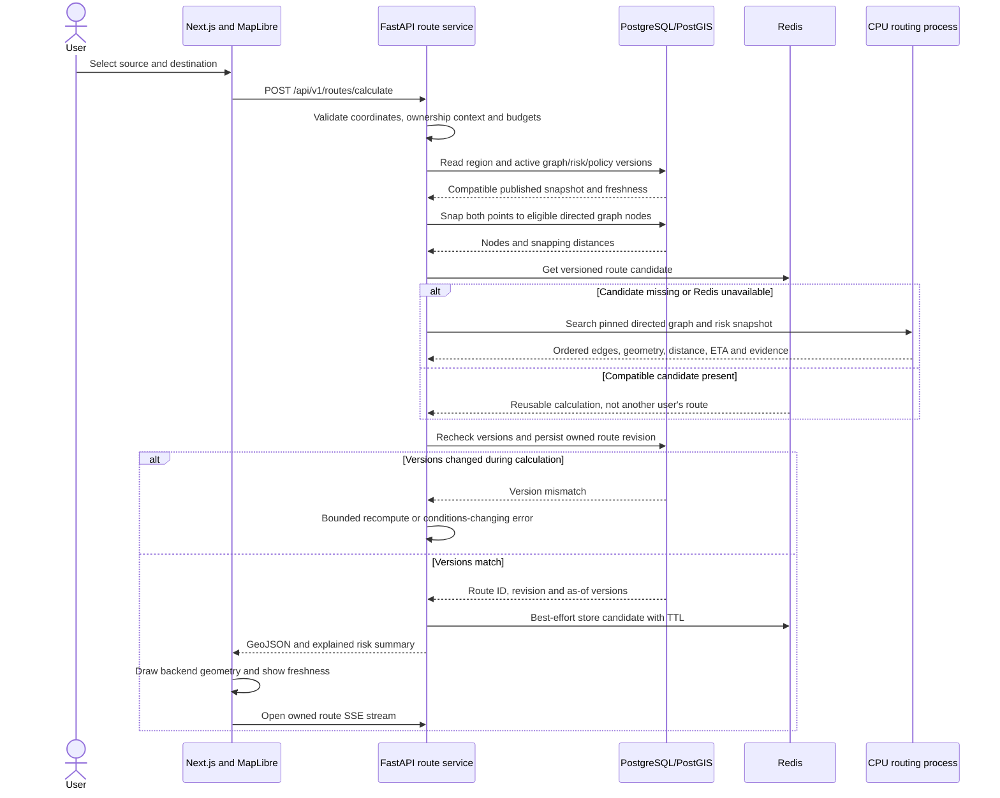
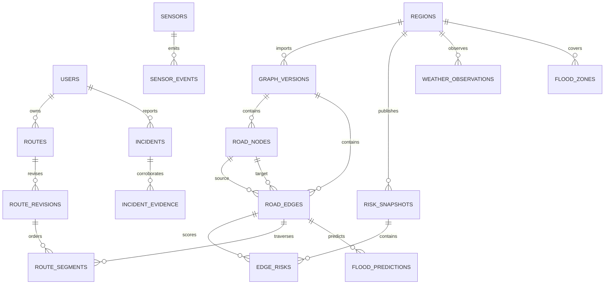

# FloodGuard system design

Status: Phase 0 engineering specification. All behavior below is proposed, not implemented. Component/deployment diagrams are in [architecture.md](architecture.md); contracts are in [api-overview.md](api-overview.md) and [events.md](events.md).

Phase 2 persistence update: [database.md](database.md) is the current implemented schema. It includes regional graph identity and graph-compatible FKs. Current `routes` rows are saved calculations, with ordered `route_segments`; stable journey heads, scoped anonymous ownership and `route_revisions` must be added before route APIs. Risk/policy strings are lineage labels until authoritative snapshot tables arrive. Auth identity, import validation, risk computation and other behavior described below remain future contracts.

## Nonnegotiable invariants

1. A route uses one active regional graph version and one immutable risk snapshot compatible with that graph. Never mix weights from different snapshots during search.
2. Verified closures and configured impassable water depths exclude edges in every mode, including FASTEST. Missing data is unknown, not zero flood risk.
3. All edge costs are finite and nonnegative. A* uses a proven lower bound or a zero heuristic. Dijkstra remains the correctness reference.
4. A committed domain change and its event intent share one PostgreSQL transaction. A consumer's durable inbox record and state changes share another transaction.
5. Cache keys include graph/risk/policy versions; a request cannot trust a cached Redis version as proof of current safety.
6. Predictions, observations and route estimates expose timestamps, provenance and expiry. Evidence expiration itself can change published risk.
7. Route reads/streams/reports/admin actions enforce ownership and authorization independently of resource IDs.
8. Freshness is an as-of claim: data may change after a response. Expose processing lag and uncertainty instead of promising real-time or guaranteed safety.

## Route request through the entire system



Detailed transaction protocol:

1. Validate finite longitude/latitude, source/destination within one enabled region, mode, algorithm and session. Reject oversized geometry/radius/time windows. Enforce route concurrency admission before expensive work.
2. Read the region's authoritative active versions and processing freshness from PostgreSQL in a short transaction. If severe intake lag or expired evidence prevents a usable assessment, return a typed degraded/unavailable result rather than a healthy claim.
3. Pin immutable graph/risk data. Bound nearest-node lookup by configurable distance and vehicle eligibility. Record snapped coordinates and offsets; do not present the off-road connector as a validated road route.
4. Look up a reusable calculation by exact validated endpoints, snapped nodes, region, mode, algorithm, graph/risk/policy versions and request schema. A cache hit still creates an owned route resource. Never cache another user's route ID, access/session data, incident text or conversation.
5. On a miss, run bounded Dijkstra/A* in a CPU process with the pinned snapshot. Reconstruct ordered directed edges and preserve edge orientation in GeoJSON. Calculate distance/ETA from physical edge attributes, separately from weighted risk cost.
6. Recheck active versions when committing the route. Use a short shared lock on the regional version row; risk/graph publication takes an exclusive lock on that row. Hold no database locks while computing. If versions changed, recompute at most twice; continued churn returns `503 CONDITIONS_CHANGING` with retry guidance.
7. Persist route head, immutable revision and ordered segments atomically. Response describes the committed snapshot and `evaluated_at`; risk may change immediately afterward. Event-driven invalidation is responsible for active journeys.
8. The frontend draws only returned geometry, displays risk/quality evidence, and subscribes to route revisions. The core calculation waits for neither a provider fetch, AWS queue, ML inference nor Bedrock.

## Database architecture and domain entities

All timestamps are timezone-aware UTC; the UI localizes display. Public entities use opaque UUIDs; OSM identifiers remain bigint source identifiers. GeoJSON uses `[longitude, latitude]`. Store source values/units and normalized SI values explicitly; never infer units from a field name alone.

| Required table/entity | Important data and relationships | Spatial representation |
| --- | --- | --- |
| `users` | UUID, unique OIDC issuer/subject pair, role, account state; local passwords only if local auth is later chosen | None |
| `road_nodes` | Internal ID, region ID, graph version, OSM node ID, traversability; unique import identity | `geometry(Point,4326)` |
| `road_edges` | Internal directed edge ID, source/target node FKs, region/graph version, OSM way/segment/direction identity, road class, length m, speed m/s, baseline seconds, access and restriction metadata | `geometry(LineString,4326)` oriented source to target |
| `flood_zones` | Region, source, external ID, revision, severity, confidence, valid-from/to, verification status | Valid `geometry(MultiPolygon,4326)` |
| `sensor_events` | Immutable event/producer identity, sensor ID, type, normalized value/unit, measured/received times, quality and provenance | `geometry(Point,4326)` |
| `weather_observations` | Provider/station/location identity, interval, accumulated rain versus intensity, units, source payload hash, observed/received time and expiry | `geometry(Point,4326)` |
| `incidents` | Reporter/session, type, description, severity, observed/received time, confidence, verification state, optional authorized image reference | `geometry(Point,4326)` |
| `routes` | Stable UUID, user or anonymous owner, region, requested endpoints, mode/algorithm, current revision, subscription expiry and status | Source/destination `geometry(Point,4326)` |
| `route_segments` | Route/revision FK, ordinal, edge ID, graph version, distance/time, edge risk and evidence references; unique revision/ordinal | Referenced road edge; optional immutable geometry copy for retention |
| `flood_predictions` | Target edge/area, probability, forecast horizon, feature/model/dataset versions, feature cutoff, predicted/expiry time, confidence/quality | Optional target `geometry(MultiPolygon,4326)`; explicit edge FK for edge predictions |

Supporting tables have concrete purposes and are introduced when needed:

| Table | Phase | Reason |
| --- | --- | --- |
| `regions`, `graph_versions` | 2–4 | Coverage geometry, import manifest, active pointers and atomic graph activation |
| `sensors` | 7 | Producer registration, status and failure/staleness tracking |
| `risk_snapshots`, `edge_risks` | 6 | Immutable snapshot header and per-edge risk, eligibility, quality and provenance |
| `route_revisions` | 5; expanded in 8 | Immutable route path/summary and version lineage; segment FK target |
| `incident_evidence` | 19 | Independent confirmations with uniqueness/provenance |
| `outbox_events`, `processed_messages` | 7 local; extended in 14 | Durable publication and per-consumer inbox deduplication |
| `jobs`, `route_feed` | 8 | Coalesced reroute work and durable per-route stream cursor |
| `model_registry` | 12/32 | Approved manifests, promotion/rollback and training/feature lineage |
| `api_idempotency`, `sessions`, `audit_entries` | At the first protected/retryable workflow | Request replay, revocable ownership and operator traceability |



Enforce graph-compatible edge/node FKs and route-compatible revision/segment FKs, `length_m > 0`, `speed_mps > 0`, finite nonnegative costs, risk/probability in `[0,1]`, and valid ordered times. A route has exactly one owner: user or anonymous session, enforced by a check constraint. Keep ingestion quality flags for rejected/late observations rather than silently overwriting history. Exclude self-loops/zero-length artifacts during import unless explicitly supported with tested behavior.

### Geometry and indexes

Use geometry in EPSG:4326 for map display/intersections. Use geography casts for metric distance/length; provide a matching GiST expression index on `(geom::geography)` when those queries are frequent. Do not use longitude/latitude degrees as meters or assume Web Mercator distance is locally exact. Meter-radius lookup uses indexed `ST_DWithin` then exact distance ordering; deterministic ID breaks ties. PostGIS documents geography distance units and index-aware bounding filters in [ST_DWithin](https://postgis.net/docs/ST_DWithin.html).

| Index/constraint | Query or invariant it supports |
| --- | --- |
| GiST on node geography expression | Bounded nearest-road-node candidates in meters |
| GiST on edge geometry | Road/flood intersection candidates and map bounding boxes |
| GiST on zone geometry; incident/sensor geography when proximity is frequent | Polygon intersections, corroboration radius and map filtering |
| B-tree `(region_id, graph_version, source_node_id)` | Directed adjacency loading and version isolation |
| B-tree `(region_id, graph_version, target_node_id)` | Reverse reachability and foreign-key maintenance |
| Unique graph/OSM identities | Idempotent imports without parallel-edge loss |
| Unique `(snapshot_id, edge_id)` on edge risks | One score per edge per immutable snapshot |
| `(sensor_id, observed_at DESC)` and `(provider, location_key, observed_at DESC)` | Latest evidence and historical feature windows |
| Unique `(producer_id, source_event_id)` on observations | Retry-safe ingestion |
| `(edge_id, route_id, revision)` on segments | Find current journeys intersecting changed edges; join current revision |
| Unique `(route_id, revision, ordinal)` on segments | Ordered reconstruction without duplicate segment positions |
| `(owner_id, created_at DESC)` on routes | Scoped route listing; anonymous session gets its own indexed owner column |
| Unique `(consumer_name, event_id)` on processed messages | Atomic consumer deduplication |
| Partial outbox index on unpublished due rows | Bounded relay polling without scanning historical events |
| Unique `(route_id, sequence)` on route feed | Ordered SSE replay and resume cursor |

Indexes are proposals to validate with representative `EXPLAIN (ANALYZE, BUFFERS)` after seeding. Add BRIN/time partitioning only when volume warrants it. Indexes speed reads but increase ingestion and migration costs; no measurable optimization is claimed yet. Migration/seed acceptance requires a real PostGIS integration database, not SQLite.

### Graph imports

Import a configurable extract/bounding region with source license/date/checksum and importer/config versions. Build a directed multigraph: split ways at intersections, retain geometry, handle `oneway=yes`, `oneway=-1`, roundabouts and motor-vehicle access; produce reverse edges only where permitted. Keep parallel roads as distinct edges. Normalize valid speed tags with documented road-class fallback and upper bound. Compute physical length before time/cost; reject inconsistent endpoints and geometry.

Import staging is idempotent by region/extract hash/config and stable way/segment/direction identity. Validate duplicate identities, dangling nodes, coordinates, connected components, directed reachability, counts, class/access distributions and sampled paths before activation. Publish a new graph and compatible initial risk snapshot together; retain old versions while referenced by routes. Initial node snapping is a documented approximation. Turn-restriction relations and mid-edge snapping require additional state/virtual edges and are deferred; without turn restrictions this is a demonstrator, not validated turn-by-turn navigation.

## Routing and deterministic risk

```mermaid
flowchart LR
    coords[Validated source and destination] --> snap[PostGIS bounded eligible-node snapping]
    graph[Versioned graph repository] --> loader[Complete regional adjacency loader]
    snapshot[Immutable risk snapshot and policy] --> costs[Eligibility and edge cost builder]
    snap --> search[Pure Dijkstra or A* search]
    loader --> search
    costs --> search
    search --> edges[Ordered predecessor-edge reconstruction]
    edges --> assemble[Oriented geometry, physical distance and ETA]
    assemble --> explain[Risk and evidence summary]
    explain --> commit[Version-checked route revision commit]
```

The pure engine accepts an adjacency map, source/target IDs, immutable edge eligibility/costs and an algorithm. Return ordered edge IDs, not just nodes, to preserve parallel-edge identity. Use a binary heap with stale-entry checks, deterministic tie ordering and predecessor-edge reconstruction. A disconnected or closure-blocked journey returns a typed no-route result. Impose visited-node, time and memory budgets; exhaustion is an error, never an incomplete route represented as valid.

Define normalized evidence `x_i` in `[0,1]` using versioned physical bounds. Rain accumulation and rain intensity are different features. Unknown values use explicit conservative priors plus quality flags; stale readings do not turn into zeros. Deterministic risk `r_e = clamp(sum(alpha_i * x_i), 0, 1)` uses configured weights with `sum(alpha_i)=1`. Features include rainfall, water depth, flood history, elevation susceptibility, road/drainage properties, zone overlap and corroborated incidents. Their calibration remains a Phase 6 decision based on source coverage, with synthetic demo settings labeled as such.

Let `t_e` be baseline seconds, `l_e` length in meters, `r_e` normalized risk, `d_e` normalized water depth and `q_e` normalized rain. Use the versioned policy:

```text
eligible(e) = access_allowed AND NOT verified_closure AND depth_below_impassable_limit
cost(e) = a_time * t_e
        + (l_e / reference_length_m) *
          (lambda_risk_seconds * r_e
           + lambda_depth_seconds * d_e
           + lambda_rain_seconds * q_e)
```

All coefficients are nonnegative and `a_time > 0`. Penalties are seconds-equivalent policy terms, so summing them with time is dimensionally defined. Length-weighting avoids multiplying risk merely because an importer splits one road into more edges. The heuristic is `h(n) = a_time * straight_line_lower_bound_m(n, goal) / global_speed_upper_bound_mps`. Use a geometric lower bound validated against imported edge lengths; if that proof/check is unavailable, use `h=0`. Risk penalties cannot reduce the lower bound. The same heuristic/cost assumptions must be tested against Dijkstra, including multiedges, one-way roads and closures.

| Mode | Policy intent |
| --- | --- |
| FASTEST | Minimize time among eligible roads; small or zero soft-risk penalties, closures still excluded |
| BALANCED | Moderate configured risk/depth/rain penalties |
| SAFEST | Larger penalties, optionally stricter configured eligibility thresholds |

SAFEST means minimizing the configured cost, not a mathematically guaranteed lowest-probability route. Expose the policy version. Explain per-route length-weighted risk, maximum edge risk, exposed length, verified closures avoided, evidence quality and ML use. These scores are not a calibrated journey flood probability; do not multiply independent-edge probabilities when correlated flooding invalidates that assumption.

## Publishing risk and dynamic rerouting

```mermaid
sequenceDiagram
    participant Producer as Sensor or simulator
    participant API as Ingestion API
    participant DB as PostgreSQL
    participant Bus as Local dispatcher or EventBridge and SQS
    participant Risk as Risk worker
    participant Reroute as Reroute worker
    participant UI as SSE gateway and browser
    Producer->>API: Seeded observation with source identity
    API->>DB: Observation and outbox transaction
    API-->>Producer: 202 accepted, processing pending
    DB-->>Bus: Relay SensorReadingReceived
    Bus->>Risk: At-least-once event
    Risk->>DB: Read current evidence, compute staged edge scores
    Risk->>DB: CAS publish immutable snapshot, version, inbox and outbox
    DB-->>Bus: Relay FloodRiskUpdated
    Bus->>Reroute: Changed edges and target version
    Reroute->>DB: Mark impacted active revisions stale; enqueue/coalesce jobs
    DB-->>UI: Durable RouteInvalidated feed entry
    Reroute->>Reroute: Recalculate on latest compatible snapshot
    Reroute->>DB: CAS current revision and risk version; commit new revision/feed/outbox
    DB-->>UI: RouteRecalculated or RouteUnavailable
    UI->>UI: Show old route, affected segment and new route
```

Risk processing derives a full logical snapshot from current eligible evidence, not from arrival order. Only newer source sequences/timestamps advance a sensor's current state; late history remains available for training/audits. Build immutable candidate snapshots off-lock. Atomically activate with a compare-and-swap on prior version, graph and evidence watermark; superseded work rebuilds from the latest evidence. Materialize complete edge scores initially; structural sharing is a later measured optimization.

Raw ingestion acceptance does not mean published risk has changed. Report latest accepted/applied watermarks and processing lag. A scheduler emits freshness-expiry work, and the synchronous route gate checks freshness so a stopped worker cannot silently keep serving healthy-looking assessments from old readings.

Join changed edges with segments of active, unexpired current route revisions. Initially invalidate all subscribed routes in the changed region for conservative correctness; refine to impacted edges after tests. Closures invalidate immediately; soft score changes use a configurable hysteresis and coalescing window. Improvements on alternate roads can change optimal paths even when current edges are untouched, so periodic regional reevaluation is required for any future selective strategy.

Use one durable job per `(route_id, target_risk_version)` and a route job lease; replace pending older targets with the newest. Bound retries and avoid recalculating every received sensor event. Defaults proposed for initial experiments: 1-second soft-change debounce, immediate hard-closure invalidation, and a minimum 5-second interval for noncritical soft reroutes. These are tunable values, not latency guarantees.

Compute outside the transaction. Commit a revision only if its predecessor is still current and target versions still match. A superseded calculation cannot overwrite a newer route. Persist old/new revision IDs, affected edges, physical ETA difference and comparable risk-score reduction. Keep the old revision for display. If all alternatives are blocked, emit RouteUnavailable, mark the current route unusable and show that fact; never retain an unsafe route as the recommended path.

The SSE gateway reads a durable ordered route feed and validates ownership. Redis pub/sub is only a wake-up; periodic cursor polling survives missed messages or Redis loss. Keep replay retention configurable. A cursor outside retention gets `resync_required`, followed by a fresh route fetch. Monotonic route revisions allow reconnecting clients to ignore duplicate/out-of-order notifications across API replicas.

## Caches and invalidation

| Cache | Key components | Proposed starting TTL | Authority/failure behavior |
| --- | --- | --- | --- |
| Regional graph serialization | Region, immutable graph version, format version | 1 hour | Database/import manifest; process-local warm copy remains usable |
| Route candidate | Region, exact validated endpoints, snapped nodes, graph/risk/policy versions, mode, algorithm, schema | 60 seconds | Database version checked before hit and before route commit |
| Flood-zone viewport | Region, bbox, zoom/aggregation, zone and risk versions | 30 seconds | Database fallback; response retains freshness metadata |
| Weather observation fetch | Provider, coordinate/station key, variables/interval, provider schema | Provider-derived; initially 5 minutes | Label stale-on-error only within a separate maximum age |

Exact endpoint identity prevents a shared cache from returning another user's off-road connector. Do not round into a coarse cell without a proven correctness bound. Cache value validation rejects mismatched metadata. Graph refresh clears incompatible in-process snapshots. Risk/zone/policy publication changes the authoritative key namespace; old entries can expire naturally. Targeted cleanup is for memory, not correctness. New requests must read authoritative versions from PostgreSQL; asynchronous Redis invalidation alone has a stale-serving race.

Record cache hit/miss/error counters and actual latency. Redis outage disables caching and pub/sub but not core calculations; rate limiting falls back to bounded per-instance controls plus edge protection. Database failure prevents version validation and new routes; fail clearly rather than serve a cached route as current.

## Weather, incidents, ML and assistant

Provider ports return typed rainfall/weather/water-level/history observations with units, interval, timestamp, source and quality. Implement mock, real and cached adapters. The initial candidate real provider is Open-Meteo; its free endpoint is for noncommercial use, so production usage must match [the provider's terms](https://open-meteo.com/en/terms), with coverage and operating limits checked in Phase 10. Distinguish observed, modeled and forecast values explicitly; forecast rain cannot masquerade as a measured sensor reading. Keep provider choice configurable and secrets in environment/Secrets Manager. Use deadlines, bounded jittered retries for temporary failures, rate-limit backoff and maximum staleness; missing water-level coverage is explicit. Network polling writes through ingestion and never blocks a route search.

Incident confidence combines distinct credible reporters, recency, spatial grouping and sensor/operator confirmation. Deduplicate actor/type/location/time-window candidates and constrain submission rates. Several copies from one reporter are one signal. Verification records actor/time/reason; only a defined verified closure or sufficient independent evidence can change eligibility. Treat images as bounded private uploads with content checks; an image URL is not an arbitrary fetch target.

Offline ML reads immutable raw dataset versions. Validate units, duplicates, timestamp ordering, target definition and geographic provenance. Use a shared versioned feature module for training/inference: current and 1h/3h/24h rain, water depth, elevation, historic floods strictly before cutoff, road/drainage proxies, water-body distance, and seasonal features. Never use observations after the prediction cutoff or label-derived confirmations as contemporaneous features. Time-based splits plus geographically/event-grouped holdouts prevent the same storm or neighboring road observations from leaking across splits. Fit imputation, scaling, resampling and selection on training only.

Persist split manifests, source checksums, feature configuration and deterministic seeds; output Parquet plus metadata. Compare logistic regression and XGBoost/LightGBM using precision, recall, F1, ROC-AUC, PR-AUC and confusion matrix; specify prediction horizon and operating threshold, handle missing-class metrics explicitly and review imbalance/calibration. Report held-out metrics, never invented targets as results. Promote only a reviewed manifest containing artifact checksum, versions, feature list/order, preprocessing, training environment and dataset lineage.

Inference validates finite values and feature version/order, loads only trusted signed/checksummed project artifacts, and returns probability/model/version/horizon/expiry/quality. A checksum confirms integrity, not that arbitrary serialized Python is safe. Prefer constrained artifact formats or approved-only serialization. Risk policy may blend `r_e = (1-beta)*r_deterministic + beta*p_ml` with a configured beta; a calibrated forecast remains separate from verified closures. Inference failures, incompatible artifacts, stale features or expired predictions fall back to deterministic scoring and emit telemetry. Bedrock is not part of inference.

The assistant uses Bedrock Converse with a fixed allowlist: `get_current_weather`, `get_flood_risk`, `calculate_safe_route`, `get_nearby_incidents`, `get_route_risk`, and `get_nearby_safe_locations`. Backend tool execution validates schemas, checks caller permissions, uses bounded query/result sizes and supplies timestamped evidence IDs. Suggested safe locations require an independently maintained/verified dataset; if absent, that tool returns unavailable. The model cannot manufacture shelters. Ground each explanation in tool evidence, state unknown/stale conditions, and avoid guaranteed-safety claims. Cap conversation length, tool rounds, output and total deadline. If grounding is unavailable, return an explicit inability to assess. Tool support and chosen model capability must be verified against [Bedrock Converse documentation](https://docs.aws.amazon.com/bedrock/latest/userguide/conversation-inference.html).

## Synchronous versus asynchronous work

| Operation | Request behavior | Durable async follow-up |
| --- | --- | --- |
| Calculate/read a route | Synchronous bounded DB/cache/search, 201/200 | Register active journey, later invalidate/reroute |
| Read risk/zones/weather/incidents | Synchronous published snapshot with freshness | Scheduled provider refresh/expiry handling |
| Submit sensor observation/report | Validate and transactionally accept, 202 | Risk aggregation, confidence/prediction processing |
| Verify incident/closure | Commit authorized evidence, 202 until applied | Priority risk publication and rerouting |
| Start simulation/graph import/training | Authorized durable job, 202 | Seeded events, staging validation, artifact creation |
| ML inference for road risk | Worker-side bounded operation | Prediction storage and risk publication |
| Assistant conversation | Bounded synchronous orchestration, optional token streaming | Optional audit/usage events; core routing independent |
| Send notification | Not waited on by route request | Queue adapter and delivery receipts |
| Migrations/deployment | Operational pipeline gate | One-off controlled tasks; not a public API request |

## Observability, resilience and verification

Every request receives `request_id` and a validated/generated `correlation_id`. Domain events also carry `event_id` and `causation_id`; worker logs retain them. JSON logs record versions, outcome, duration and retry context without precise journey payloads. Metrics use bounded labels: HTTP volume/errors/latency, algorithm durations, recalculations, cache ratio, queue age/depth/DLQ, DB pool wait/use, snapshot age/publication lag, inference latency/fallback and assistant/tool errors. Alarm limits are provisional until staging load tests establish baselines.

| Failure | Required behavior |
| --- | --- |
| Redis unavailable | Compute from pinned DB snapshots; cursor-poll SSE; degraded cache metrics |
| PostgreSQL unavailable | Stop mutations/new verified-current routes; return 503; queue retries retain work |
| Weather provider timeout | Use explicitly labeled last observation within allowed age, otherwise unknown/degraded |
| ML unavailable | Deterministic risk path and fallback event/metric |
| Bedrock unavailable | Core routes unaffected; assistant returns a typed error |
| Duplicate/out-of-order event | Transactional inbox plus evidence/version guards; no duplicated state |
| Worker crash | Lease/visibility expires, retry resumes; compare-and-swap prevents stale commit |
| Malformed event | Bounded handling to quarantine/DLQ with reason; healthy work continues |
| EventBridge/SQS unavailable | Accepted writes retained in outbox; publication lag alarms and freshness gate |
| SSE disconnect | Reconnect with cursor or resync; stale status and revision polling |
| No eligible alternative | RouteUnavailable with impacted path shown as unusable |

Plan tests for deterministic known graphs, A*/Dijkstra parity, segmentation-invariant costs, closure exclusions, unknown/freshness handling, PostGIS indexes/queries, migrations/seed, cache version races, consumer duplicates/crash boundaries, route CAS, SSE replay and authorization. E2E uses a seeded graph/scenario with a known normal path and safer detour; verify actual map/backend behavior. Test assistant grounding through deterministic tool fixtures before calling a live model.

Performance work must capture graph/data sizes, hardware/container limits, software versions, warm/cold cache conditions, concurrency, request mix, p50/p95/p99/error rate, resource usage and before/after changes. Scale k6 clients gradually; report unrun cases and failures honestly. The Phase 0 acceptance walkthrough is the route sequence above plus the flood-update sequence. There are no measured benchmarks, trained models or successful deployment claims at this stage.
